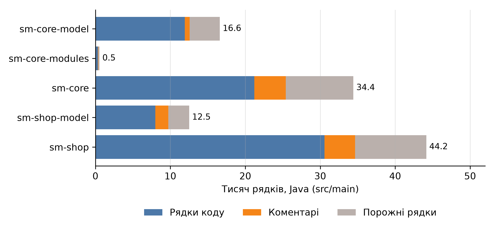
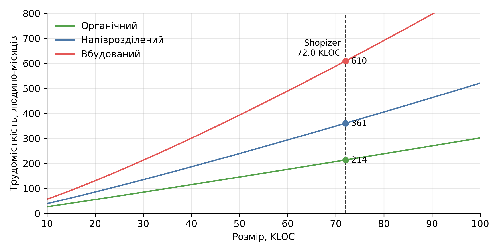
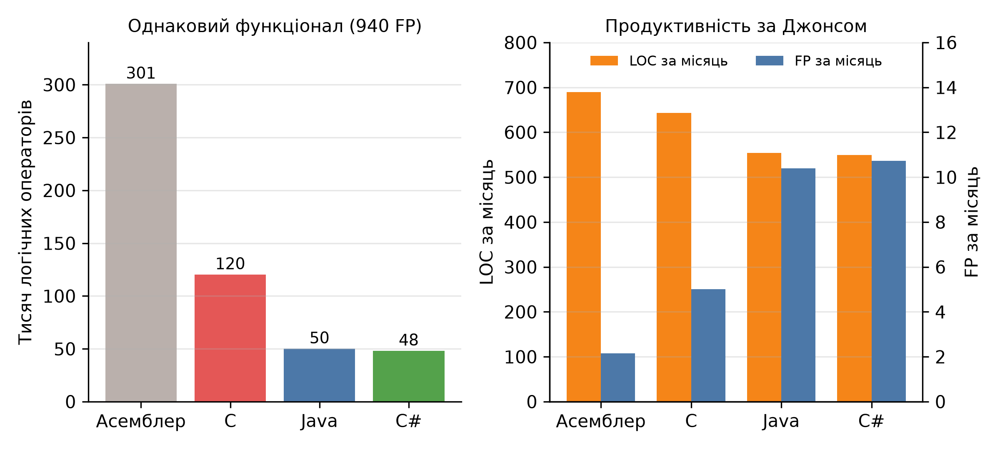

# Мета роботи

Ознайомитися з загальними поняттями щодо вимірювань та метрикою розміру Lines of Code. Напрацювати вміння застосування засобів вимірювання метрики. Отримати загальні вміння щодо застосування метрики в економіці програмного забезпечення.

# Завдання

1. Застосовуючи вимірювачі у відповідних середовищах програмування, на прикладі програмних текстів виконати вимірювання розміру.
2. Здійснити відповідні економічні розрахунки.
3. Дослідити рівні мов програмування C# та Java.

# 1. Об'єкт вимірювання

Вимірювання виконано на прикладі відкритого застосунку Shopizer – інтернет-магазину на Java з відкритим кодом (ліцензія Apache-2.0) [1]. Взято стан репозиторію на коміті 6a4a0a6 від 23.03.2025. Застосунок обрано тому, що це типова бізнес-система з каталогом товарів, замовленнями, клієнтами і платежами, а за розміром він перевищує 25 тисяч рядків, що потрібно для подальших розрахунків.

Застосунок складається з п'яти Maven-модулів (таблиця 1).

Таблиця 1 – Модулі Shopizer

| Модуль | Призначення |
| ---------------- | ---------------------------------------------------------------- |
| sm-core-model | Сутності предметної області і константи |
| sm-core-modules | Інтерфейси інтеграційних модулів, шифрування, геолокація |
| sm-core | Бізнес-логіка, сервіси і репозиторії |
| sm-shop-model | Моделі даних і валідація для рівня API |
| sm-shop | Контролери і налаштування застосунку |

Окрім Java, у репозиторії є шаблони FreeMarker, файли конфігурації, JSON і скрипти збірки. Вони складають 11 106 рядків коду з 86 682 і в розрахунках не враховуються, бо метрика LOC порівнює програмні тексти однією мовою.

# 2. Засоби і методика вимірювання

Для вимірювання використано лічильник cloc версії 2.10 [2]. Він окремо рахує порожні рядки, рядки коментарів і рядки коду; рядок із кодом і коментарем у кінці рахується як код. Для кожного модуля окремо виміряно основний код (src/main) і тести (src/test).

Крім фізичних рядків, виміряно логічні оператори. За визначенням SEI фізичний рядок закінчується символом переходу на новий рядок, а логічний оператор – це одна інструкція незалежно від того, скільки рядків вона займає [3]. Для логічних операторів cloc не придатний, тому вихідні файли розібрано парсером Java [4]. Логічним рядком вважався один оператор (присвоєння, виклик, умова, цикл, return, throw, блок try і catch) або одна декларація (пакет, імпорт, клас, інтерфейс, перелік, метод, конструктор, поле, локальна змінна). Анотації окремо не рахувались.

Отже, розмір застосунку вимірюється трьома способами:

1. Фізичні рядки, $N_{phys}$ – усі рядки файлів.
2. Рядки коду, $N_{loc}$ – фізичні рядки без порожніх і рядків коментарів.
3. Логічні оператори, $N_{lloc}$ – кількість операторів і декларацій.

Рівень коментарів обчислено як непряму метрику $F = N_{com} / N_{loc}$, де $N_{com}$ – кількість рядків коментарів.

# 3. Результати вимірювання

Результати вимірювання основного коду Java за модулями наведено в таблиці 2, склад рядків – на рисунку 1.

Таблиця 2 – Розмір основного коду Java за модулями

| Модуль | Файлів | Фізичні | Код | Коментарі | Порожні | Логічні |
| --------------- | ------ | ------- | ------ | --------- | ------- | ------- |
| sm-core-model | 186 | 16 586 | 11 931 | 652 | 4 003 | 7 809 |
| sm-core-modules | 14 | 527 | 317 | 68 | 142 | 237 |
| sm-core | 335 | 34 420 | 21 207 | 4 187 | 9 026 | 15 056 |
| sm-shop-model | 322 | 12 507 | 7 996 | 1 743 | 2 768 | 5 922 |
| sm-shop | 310 | 44 151 | 30 565 | 4 073 | 9 513 | 21 109 |
| Разом | 1 167 | 108 191 | 72 016 | 10 723 | 25 452 | 50 133 |

{width=15cm}

Рисунок 1 – Склад основного коду за модулями

Тести містяться лише в модулях sm-core (22 файли) і sm-shop (15 файлів) і складають 3 495 рядків коду, 1 109 рядків коментарів і 3 059 логічних операторів. Це 4.9% від обсягу основного коду, тестів у проєкті мало, тому далі розмір рахується за основним кодом.

Частки у фізичних рядках основного коду: код – 66.6%, порожні рядки – 23.5%, коментарі – 9.9%. Рівень коментарів $F = 10\,723 / 72\,016 = 0.149$, тобто один рядок коментаря на сім рядків коду. Відношення логічних операторів до рядків коду $N_{lloc} / N_{loc} = 0.70$.

Різниця між трьома способами вимірювання великої: за тим самим текстом розмір становить 108.2, 72.0 або 50.1 тисячі рядків. Яку величину брати за розмір $size$ у формулах, залежить від того, для якої моделі готувались коефіцієнти. Базова модель COCOMO використовує тисячі рядків вихідного коду без коментарів [5], тому в основних розрахунках далі береться $N_{loc} = 72.016$ KLOC, а інші способи вимірювання використано для перевірки чутливості.

# 4. Економічні розрахунки

## 4.1. Формули

Трудомісткість, тривалість і вартість обчислено за базовою моделлю COCOMO [5]:

$$Effort = a \cdot size^{b},$$

$$Schedule = c \cdot Effort^{d},$$

$$Cost = Effort \cdot salary,$$

де $Effort$ – трудомісткість у людино-місяцях, $size$ – розмір у KLOC, $Schedule$ – тривалість розробки в місяцях, $salary$ – місячна зарплата розробника, $a$, $b$, $c$, $d$ – коефіцієнти типу проєкту (таблиця 3). Середня кількість розробників $N = Effort / Schedule$.

Таблиця 3 – Коефіцієнти моделі за типами проєктів

| Тип проєкту | $a$ | $b$ | $c$ | $d$ | Розмір |
| ---------------- | ---- | ---- | ---- | ---- | -------------- |
| Органічний | 2.4 | 1.05 | 2.5 | 0.38 | до 25 KLOC |
| Напіврозділений | 3.0 | 1.12 | 2.5 | 0.35 | до 75 KLOC |
| Вбудований | 3.6 | 1.20 | 2.5 | 0.32 | без обмеження |

Як $salary$ узято медіану місячної зарплати розробника рівня Middle (усі мови) в Україні – \$2 500 (чиста, червень 2026) [6]. Для вартості в гривнях використано офіційний курс НБУ на 04.11.2026 – 45.666 грн за долар [7].

## 4.2. Вибір типу проєкту

Розмір застосунку 72.0 KLOC входить в діапазон напіврозділеного типу (25–75 KLOC). Інтернет-магазин не має жорстких апаратних і експлуатаційних обмежень, тому вбудований тип не підходить, а за розміром і складністю (п'ять модулів, інтеграційні модулі, відкритий проєкт без жорсткої організації розробки) він ближчий до напіврозділеного, ніж до органічного. Діапазони розміру в таблиці 3 орієнтовні: тип проєкту визначається характером проєкту (обмеження, досвід команди, жорсткість вимог), а не лише розміром. Для порівняння розраховано всі три типи. У таблиці 5 тип лишається напіврозділеним за будь-якого способу вимірювання, щоб відокремити вплив розміру від впливу типу, хоча 108.2 KLOC фізичних рядків і 75.5 KLOC з тестами за розміром лежать на межі або за межею діапазону.

## 4.3. Розрахунок для напіврозділеного типу

$$Effort = 3.0 \cdot 72.016^{1.12} = 360.9\ \text{людино-місяців},$$

$$Schedule = 2.5 \cdot 360.9^{0.35} = 19.6\ \text{місяця},$$

$$N = \frac{360.9}{19.6} = 18.4\ \text{розробника},$$

$$Cost = 360.9 \cdot 2\,500 = \$902\,364 \approx 41.2\ \text{млн грн}.$$

Питома вартість рядка коду $Cost / N_{loc} = \$12.53$, продуктивність $N_{loc} / Effort = 200$ LOC на людино-місяць.

Результати для всіх типів наведено в таблиці 4, а залежність трудомісткості від розміру – на рисунку 2.

Таблиця 4 – Економічні показники для основного коду Java (72.016 KLOC)

| Показник | Органічний | Напіврозділений | Вбудований |
| ------------------------------- | ---------- | --------------- | ---------- |
| Трудомісткість, людино-місяців | 214.0 | 360.9 | 609.8 |
| Тривалість, місяців | 19.2 | 19.6 | 19.5 |
| Середня кількість розробників | 11.1 | 18.4 | 31.3 |
| Вартість, \$ | 535 121 | 902 364 | 1 524 605 |
| Вартість, млн грн | 24.4 | 41.2 | 69.6 |
| Вартість одного рядка, \$/LOC | 7.43 | 12.53 | 21.17 |
| Продуктивність, LOC на людино-місяць | 336 | 200 | 118 |

{width=15cm}

Рисунок 2 – Трудомісткість за базовою моделлю COCOMO залежно від розміру

## 4.4. Чутливість до способу вимірювання

Розрахунок для напіврозділеного типу за кожним способом вимірювання розміру наведено в таблиці 5.

Таблиця 5 – Вплив способу вимірювання розміру на результат

| Розмір | KLOC | Трудомісткість, людино-місяців | Тривалість, місяців | Вартість, \$ |
| ------------------------------ | ---------- | -------------------- | ------------------ | ------------- |
| Фізичні рядки | 108.191 | 569.4 | 23.0 | 1 423 493 |
| Рядки коду (основний код) | 72.016 | 360.9 | 19.6 | 902 364 |
| Логічні оператори | 50.133 | 240.6 | 17.0 | 601 450 |
| Рядки коду, основний код і тести | 75.511 | 380.6 | 20.0 | 951 552 |

Якщо до розміру додати тести, трудомісткість зростає лише на 5.5%. Вибір способу вимірювання змінює оцінку набагато сильніше: від 240.6 до 569.4 людино-місяця, тобто в 2.4 раза.

# 5. Рівні мов програмування C# та Java

## 5.1. Рівень мови

Рівень мови показує, скільки логічних операторів потрібно, щоб реалізувати одну функціональну точку. Еталоном є асемблер: його рівень дорівнює 1, і на одну функціональну точку припадає 320 операторів. Для мови з рівнем $L$ кількість операторів на одну функціональну точку становить приблизно $320 / L$ [8]. Чим вищий рівень, тим менше коду потрібно для того самого функціоналу.

Значення для C# і Java з таблиці Джонса та з таблиці QSM наведено в таблиці 6. Для порівняння додано C і асемблер.

Таблиця 6 – Рівні мов за даними Джонса і QSM

| Мова | Рівень (Джонс) | Операторів на FP (Джонс) | Операторів на FP (QSM, середнє) | Операторів на FP (QSM, медіана) | Діапазон (QSM) |
| ------------ | ------------ | ------------ | ------------ | ------------ | ------------ |
| Асемблер | 1.0 | 320.00 | 119 | 98 | 25–320 |
| C | 2.5 | 128.00 | 97 | 99 | 39–333 |
| Java | 6.0 | 53.33 | 53 | 53 | 14–134 |
| C# | 6.25 | 51.20 | 54 | 59 | 29–70 |

Рівень C# для Джонса (6.25) обчислено з кількості операторів на FP: $320 / 51.20$. Обидві мови належать до одного рівня, близько 6, а різниця між ними менша за розкид даних усередині кожної мови: за таблицею QSM Java має від 14 до 134 операторів на FP, C# – від 29 до 70. Джонс ставить C# трохи вище, ніж Java (на 4% менше операторів), а QSM – трохи нижче (на 2% більше за середнім і на 11% за медіаною) [8, 9]. Тому надійно можна стверджувати лише, що C# і Java мають однаковий рівень у межах похибки.

## 5.2. Зворотний розрахунок функціональних точок

Кількість функціональних точок Shopizer оцінено зворотним розрахунком (backfiring), для якого використовують логічні оператори, а не фізичні рядки [8]:

$$FP = \frac{N_{lloc}}{LM} = \frac{50\,133}{53.33} = 940,$$

де $LM$ – кількість операторів на одну FP для Java. Це лише грубе наближення, бо коефіцієнти зворотного розрахунку в різних джерелах відрізняються, а за оцінкою Джонса, розкид результатів між мовами і компаніями може перевищувати 500% [8]. Точну кількість функціональних точок буде розраховано в наступній практичній роботі.

## 5.3. Вплив рівня мови на розмір і вартість

Якщо той самий функціонал на 940 FP реалізувати іншою мовою, розмір програми змінюється пропорційно кількості операторів на FP. У таблиці 7 рядки коду для інших мов отримано збереженням того самого відношення логічних операторів до рядків коду (0.70), а вартість обчислено за напіврозділеним типом так само, як у розділі 4. Для C і асемблера розмір перевищує межу типу, тому їх наведено лише для порівняння.

Таблиця 7 – Той самий функціонал (940 FP) різними мовами

| Мова | Рівень | Логічних операторів | KLOC | Трудомісткість, людино-місяців | Вартість, \$ | \$ на FP |
| ------------ | ---------- | ------------ | ---------- | ------------------ | ------------ | ---------- |
| Асемблер | 1.0 | 300 817 | 432.1 | 2 685.4 | 6 713 385 | 7 141 |
| C | 2.5 | 120 327 | 172.8 | 962.3 | 2 405 740 | 2 559 |
| Java | 6.0 | 50 133 | 72.0 | 360.9 | 902 364 | 960 |
| C# | 6.25 | 48 131 | 69.1 | 344.8 | 862 097 | 917 |

Така сама реалізація на C# була б на 4% меншою за розміром, а за COCOMO трудомісткість зменшилась би на 4.5% (на 16.1 людино-місяця, або \$40 267). Різниця між Java і C# невелика й менша за похибку самого зворотного розрахунку, тож економічно ці мови вважаються рівноцінними. Для мов нижчого рівня вона вже суттєва: C дає в 2.4 раза більший обсяг, асемблер – у 6.0 раза.

Наведені Джонсом значення продуктивності показують, чому LOC не підходить для порівняння мов (рисунок 3). Кількість рядків за місяць у Java становить 554, у C – 643, в асемблері – 690, тобто за LOC найпродуктивнішим виходить асемблер. Водночас кількість функціональних точок за місяць у Java 10.40, у C 5.02, в асемблері 2.16 [8]. Причина в тому, що трудомісткість вимог, проєктування й документації не залежить від мови і не зменшується разом з кількістю рядків.

{width=16cm}

Рисунок 3 – Обсяг коду і продуктивність за мовами

# 6. Аналіз результатів і верифікація

Перевірки результатів вимірювання:

1. Підсумок cloc збігається з незалежним підрахунком рядків: сума рядків коду, коментарів і порожніх рядків (72 016 + 10 723 + 25 452) дорівнює кількості фізичних рядків усіх файлів (108 191).
2. Парсер Java розібрав усі 1 204 файли без помилок, тож жоден файл не випав з підрахунку логічних операторів.
3. Сума Java-коду в src/main і src/test (75 511) відрізняється від результату cloc по всьому репозиторію (75 576) на 65 рядків. Це один Java-файл поза каталогами src/main і src/test.

Перевірка економічних результатів. Продуктивність за базовою моделлю становить 200 рядків на людино-місяць для напіврозділеного типу (336 для органічного, 118 для вбудованого). Джонс наводить для Java 554 рядки за місяць [8], що в 2.8 раза вище. Це різні моделі: COCOMO враховує всі роботи від вимог до приймання, а таблиця Джонса – ілюстративна з фіксованим обсягом нетехнічної роботи. Обидва значення мають один порядок і відносяться до тієї самої мови, тож результат COCOMO вважається правдоподібним.

Обмеження оцінки:

1. Оцінка чутлива до способу вимірювання: між фізичними рядками і логічними операторами трудомісткість відрізняється у 2.4 раза. Тому в висновках про розмір завжди треба вказувати, що саме рахувалося.
2. Тип проєкту змінює трудомісткість у 2.8 раза (214.0–609.8 людино-місяця), тож вибір типу треба обґрунтовувати, як у розділі 4.2.
3. Тривалість майже не залежить від типу (19.2–19.6 місяця), а різниця між типами проявляється у кількості розробників (11–31).
4. Базова модель не враховує повторне використання готових бібліотек. Shopizer побудований на Spring Boot і низці інших бібліотек, підключених через Maven, тому реальні витрати на такий застосунок, імовірно, нижчі за оцінку COCOMO. Також модель оцінює вартість за ставкою Middle (усі мови), а реальна команда має різний склад.
5. Зворотний розрахунок функціональних точок наближений, його результат буде перевірено підрахунком FP.

# Висновки

У роботі виміряно розмір відкритого застосунку Shopizer і виконано економічні розрахунки на основі метрики LOC.

1. Основний код Java має 1 167 файлів і 108 191 фізичний рядок, з яких 72 016 рядків коду, 10 723 рядки коментарів і 25 452 порожні рядки. Логічних операторів 50 133. Рівень коментарів 0.149.
2. За базовою моделлю COCOMO для напіврозділеного типу трудомісткість становить 360.9 людино-місяців, тривалість 19.6 місяця, середня кількість розробників 18.4, вартість \$902 364 (41.2 млн грн) за зарплатою \$2 500. Питома вартість – \$12.53 за рядок.
3. Результат сильно залежить від того, що вважати рядком: між фізичними рядками і логічними операторами трудомісткість відрізняється у 2.4 раза. Це головний недолік метрики LOC.
4. C# і Java мають однаковий рівень (близько 6): 51.2 і 53.3 оператора на функціональну точку за Джонсом, 54 і 53 за QSM. Різниця в розмірі між ними (4%) менша за розкид даних. Для мов нижчого рівня різниця значна: C дає в 2.4 раза більше коду, асемблер – у 6.0 раза.
5. За LOC продуктивність мов нижчого рівня виглядає вищою (690 рядків на місяць в асемблері проти 554 у Java), хоча в функціональних точках вона нижча в 4.8 раза (2.16 проти 10.40). Тому для порівняння проєктів на різних мовах LOC непридатна, і доцільно переходити до функціональних точок.

# Список джерел

1. Shopizer: Java open source e-commerce software. URL: https://github.com/shopizer-ecommerce/shopizer, коміт 6a4a0a6 від 23.03.2025 (дата звернення: 04.11.2026).
2. Adler D. cloc: Count Lines of Code, версія 2.10. URL: https://github.com/AlDanial/cloc (дата звернення: 04.11.2026).
3. Park R. E. Software Size Measurement: A Framework for Counting Source Statements : CMU/SEI-92-TR-020. Software Engineering Institute, Carnegie Mellon University, 1992. URL: https://sei.cmu.edu/library/software-size-measurement-a-framework-for-counting-source-statements (дата звернення: 04.11.2026).
4. javalang: Pure Python Java parser and tools. URL: https://github.com/c2nes/javalang (дата звернення: 04.11.2026).
5. Boehm B. W. Software Engineering Economics. Englewood Cliffs, NJ : Prentice-Hall, 1981. 767 p.
6. Зарплати українських розробників – літо 2026. DOU. 13.07.2026. URL: https://dou.ua/lenta/articles/salary-report-devs-summer-2026/ (дата звернення: 04.11.2026).
7. Офіційний курс гривні щодо іноземних валют на 04.11.2026: долар США 45.666 UAH. Національний банк України. URL: https://bank.gov.ua/NBUStatService/v1/statdirectory/exchange?valcode=USD&date=20261104&json (дата звернення: 04.11.2026).
8. Jones C. Software Economics and Function Point Metrics: Thirty years of IFPUG Progress, версія 10.0. Namcook Analytics, 14.04.2017. URL: https://www.ifpug.org/wp-content/uploads/2017/04/IYSM.-Thirty-years-of-IFPUG.-Software-Economics-and-Function-Point-Metrics-Capers-Jones.pdf (дата звернення: 04.11.2026).
9. Function Point Languages Table, версія 5.0. QSM. URL: https://www.qsm.com/resources/function-point-languages-table (дата звернення: 04.11.2026).
