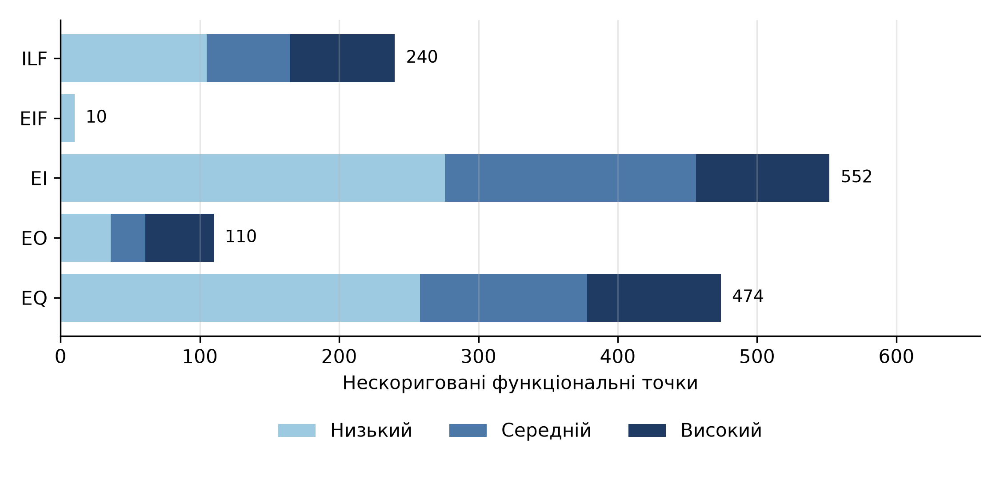
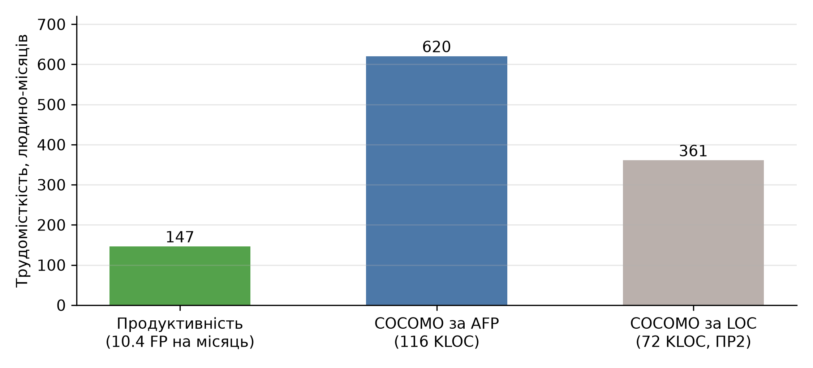

# Мета роботи

Навчитися оцінювати економічні характеристики програмних продуктів на основі аналізу функціональних точок.

# Завдання

1. Проаналізувати програмний застосунок та скласти перелік та навести докладний опис всіх внутрішніх логічних (ILF) і зовнішніх інтерфейсних (EIF) файлів, а також всіх транзакцій (EI, EO, EQ).
2. Виконати оцінки кількості RET і DET для внутрішніх логічних (ILF) і зовнішніх інтерфейсних (EIF) файлів, а також оцінки кількості FTR і DET для зовнішніх вводів (EI), виведень (EO) і запитів (EQ), оцінити складність та кількість ненормованих функціональних точок.
3. Провести аналіз ступенів впливу основних характеристик системи.
4. Розрахувати нормовану кількість функціональних точок та економічних характеристик.

# 1. Об'єкт і межі аналізу

Аналіз виконано для застосунку Shopizer, того самого, що в практичній роботі № 2 (Java, коміт 6a4a0a6) [1]. Це підрахунок функціональних точок наявного програмного продукту за методом IFPUG [2, 3].

Межа застосунку проходить по REST API серверної частини (модуль sm-shop) разом з бізнес-логікою та моделлю даних (модулі sm-core, sm-core-model). Користувачами застосунку є клієнти магазину, адміністратори і зовнішні вітрини, які звертаються до API. Адміністративний інтерфейс і вітрина є окремими застосунками й до межі не входять.

Підрахунок виконано за вихідним кодом, а не за специфікацією вимог. Тому логічні файли визначено за сутностями JPA, а елементарні процеси – за методами контролерів. Для відтворюваності обидва кроки виконано програмно, а результати переглянуто вручну; перевірку наведено в розділі 8.

Складність елементів визначається за матрицями таблиць 1–3, вагові коефіцієнти наведено в таблиці 4 [2].

Таблиця 1 – Складність внутрішніх і зовнішніх файлів (ILF, EIF)

| Типи елементів запису | 1–19 DET | 20–50 DET | 51 і більше DET |
| ------------------------ | ------------ | ------------ | ------------ |
| 1 RET | Низький | Низький | Середній |
| 2–5 RET | Низький | Середній | Високий |
| 6 і більше RET | Середній | Високий | Високий |

Таблиця 2 – Складність зовнішніх входів (EI)

| Файли (FTR) | 1–4 DET | 5–15 DET | 16 і більше DET |
| ------------------------ | ------------ | ------------ | ------------ |
| 0–1 FTR | Низький | Низький | Середній |
| 2 FTR | Низький | Середній | Високий |
| 3 і більше FTR | Середній | Високий | Високий |

Таблиця 3 – Складність зовнішніх виходів (EO) і зовнішніх запитів (EQ)

| Файли (FTR) | 1–5 DET | 6–19 DET | 20 і більше DET |
| ------------------------ | ------------ | ------------ | ------------ |
| 0–1 FTR | Низький | Низький | Середній |
| 2–3 FTR | Низький | Середній | Високий |
| 4 і більше FTR | Середній | Високий | Високий |

Таблиця 4 – Вагові коефіцієнти

| Компонент | Низький | Середній | Високий |
| ------------------------ | ------------ | ------------ | ------------ |
| ILF | 7 | 10 | 15 |
| EIF | 5 | 7 | 10 |
| EI | 3 | 4 | 6 |
| EO | 4 | 5 | 7 |
| EQ | 3 | 4 | 6 |

Для зовнішнього запиту складність визначається окремо за входом (таблиця 2) і за виходом (таблиця 3), береться більша.

# 2. Внутрішні логічні файли (ILF)

У коді є 82 сутності JPA. Сутності, які користувач сприймає як одне ціле (товар і його описи, ціни, наявність), об'єднано в один логічний файл, а кожна сутність групи вважається типом елемента запису (RET). Кількість елементів даних (DET) – це кількість полів сутностей групи без ключів, колекцій (їх представляє зворотний зв'язок) і службових полів, з урахуванням вбудованих класів (адреса клієнта) та двох полів аудиту (дати створення і зміни).

Окремо враховано файлове сховище для зображень товарів і файлів контенту. Його дані зберігає і змінює сам застосунок, тому це ILF, хоча в базі даних воно не представлене. Для нього RET = 2, DET = 7 (назва, тип, каталог, розмір, власник, вміст, магазин).

Перелік і оцінка 26 ILF наведено в таблиці 5.

Таблиця 5 – Внутрішні логічні файли

| № | Файл | Сутності (RET) | RET | DET | Складність | UFP |
| ----- | ---------------------- | ---------------------------------- | ------ | ------ | ------------------- | -------- |
| 1 | Товар | Product, ProductDescription, ProductAvailability, ProductPrice, ProductPriceDescription, DigitalProduct, ProductRelationship | 7 | 78 | Високий | 15 |
| 2 | Зображення товару | ProductImage, ProductImageDescription | 2 | 15 | Низький | 7 |
| 3 | Опції товару | ProductOption, ProductOptionDescription, ProductOptionValue, ProductOptionValueDescription, ProductOptionSet, ProductAttribute | 6 | 38 | Високий | 15 |
| 4 | Варіанти товару | ProductVariation, ProductVariant, ProductVariantGroup, ProductVariantImage, ProductVariantImageDescription | 5 | 29 | Середній | 10 |
| 5 | Тип товару | ProductType, ProductTypeDescription | 2 | 11 | Низький | 7 |
| 6 | Виробник | Manufacturer, ManufacturerDescription | 2 | 14 | Низький | 7 |
| 7 | Відгук про товар | ProductReview, ProductReviewDescription | 2 | 16 | Низький | 7 |
| 8 | Категорія | Category, CategoryDescription | 2 | 22 | Середній | 10 |
| 9 | Каталог | Catalog, CatalogCategoryEntry, CatalogDescription | 3 | 15 | Низький | 7 |
| 10 | Контент | Content, ContentDescription | 2 | 19 | Низький | 7 |
| 11 | Клієнт | Customer, CustomerAttribute, UserConnection | 3 | 53 | Високий | 15 |
| 12 | Опції клієнта | CustomerOption, CustomerOptionDescription, CustomerOptionValue, CustomerOptionValueDescription, CustomerOptionSet | 5 | 26 | Середній | 10 |
| 13 | Відгук клієнта | CustomerReview, CustomerReviewDescription | 2 | 16 | Низький | 7 |
| 14 | Магазин | MerchantStore | 1 | 27 | Низький | 7 |
| 15 | Замовлення | Order, OrderTotal, OrderAttribute, OrderProduct, OrderProductAttribute, OrderProductPrice, OrderProductDownload, OrderStatusHistory, OrderAccount, OrderAccountProduct, FileHistory | 11 | 113 | Високий | 15 |
| 16 | Платіжна транзакція | Transaction | 1 | 8 | Низький | 7 |
| 17 | Кошик | ShoppingCart, ShoppingCartItem, ShoppingCartAttributeItem | 3 | 16 | Низький | 7 |
| 18 | Доставка | ShippingOrigin, Quote | 2 | 34 | Середній | 10 |
| 19 | Податки | TaxClass, TaxRate, TaxRateDescription | 3 | 20 | Середній | 10 |
| 20 | Користувач | User, Group, Permission | 3 | 23 | Середній | 10 |
| 21 | Інтеграційний модуль | IntegrationModule | 1 | 10 | Низький | 7 |
| 22 | Конфігурація | MerchantConfiguration, SystemConfiguration | 2 | 9 | Низький | 7 |
| 23 | Підписка | Optin, CustomerOptin | 2 | 15 | Низький | 7 |
| 24 | Журнал і сповіщення | MerchantLog, SystemNotification | 2 | 11 | Низький | 7 |
| 25 | Довідники | Country, CountryDescription, Zone, ZoneDescription, Currency, Language, GeoZone, GeoZoneDescription | 8 | 30 | Високий | 15 |
| 26 | Файлове сховище | Зображення (товару), Файл (контенту) | 2 | 7 | Низький | 7 |

З 26 файлів 15 мають низьку складність, 6 – середню, 5 – високу. Найскладніші – «Замовлення» (11 RET, 113 DET), «Товар» (7 RET, 78 DET), «Клієнт» (3 RET, 53 DET), «Опції товару» і «Довідники».

# 3. Зовнішні інтерфейсні файли (EIF)

Зовнішніми інтерфейсними файлами вважаються дані, які застосунок читає, але не змінює і не зберігає. У Shopizer це:

1. Тарифи перевізників. Модулі доставки UPS і USPS запитують в зовнішніх сервісах вартість і термін доставки.
2. Платіжні шлюзи. Модулі оплати Stripe, PayPal, Braintree і BeanStream надсилають запит на списання і приймають відповідь шлюзу.

Результати наведено в таблиці 6.

Таблиця 6 – Зовнішні інтерфейсні файли

| Файл | Зміст | RET | DET | Складність | UFP |
| -------------------------- | ---------------------------------- | ------- | ------- | ------------------- | -------- |
| Тарифи перевізників (UPS, USPS) | пропозиція доставки і послуга: код, назва, ціна, валюта, термін, вага, пункти відправлення і призначення | 2 | 8 | Низький | 5 |
| Платіжні шлюзи (Stripe, PayPal, Braintree, BeanStream) | запит і відповідь шлюзу: ідентифікатор, статус, сума, валюта, токен, код помилки | 2 | 12 | Низький | 5 |

База геолокації GeoLite2-City, яка є в репозиторії, до EIF не віднесена. Її читає лише метод сервісу клієнтів getCustomerAddress, а жоден метод контролера його не викликає, тобто жодна транзакція користувача на цей файл не посилається. Електронна пошта (SMTP, AWS SES) файлом також не є: через неї застосунок тільки відправляє повідомлення, і дані з неї не читає.

# 4. Транзакції (EI, EO, EQ)

Елементарним процесом вважається метод контролера, який обробляє HTTP-запит. Методи з кількома шляхами (наприклад, /private/product/{id} і /auth/product/{id}) – це один процес, а версії API v1 і v2 – різні процеси. У результаті виділено 306 транзакцій; охоплено всі контролери модуля sm-shop.

Правила класифікації:

1. Запити POST, PUT, PATCH і DELETE, які змінюють дані, – зовнішні входи (EI).
2. Запити GET, які тільки повертають дані, – зовнішні запити (EQ).
3. Процеси з обчисленням на виході (підсумок замовлення, вартість доставки, кошик з обчисленими сумами) – зовнішні виходи (EO).
4. Автентифікація, вихід із системи та пошук не змінюють даних і не мають обчислень, тому відносяться до EQ, навіть якщо виконуються методом POST.

Для кожної транзакції визначено:

- FTR – кількість файлів (ILF і EIF), до яких вона звертається. Береться з предметної області контролера і з викликаних фасадів та сервісів.
- DET для EI – кількість полів тіла запиту (вкладені класи рахуються один раз), параметрів запиту і шляху без технічних (магазин, мова, пагінація), плюс одне поле для повідомлення про результат.
- DET для EO і EQ – кількість полів відповіді. Для EQ додатково розглянуто вхід: параметри запиту і шляху.

Підсумок за типами і складністю наведено в таблиці 7, повний перелік – у додатку А.

Таблиця 7 – Кількість транзакцій

| Тип | Низький | Середній | Високий | Усього |
| ------------------------ | ------------ | ------------ | ------------ | ------------ |
| EI | 92 | 45 | 16 | 153 |
| EO | 9 | 5 | 7 | 21 |
| EQ | 86 | 30 | 16 | 132 |
| Разом | 187 | 80 | 39 | 306 |

Кількість FTR у транзакціях: 0 файлів – 1 транзакція, 1 файл – 181, 2 – 103, 3 – 15, 4 – 2, 5 – 4. Більшість процесів працює з одним-двома файлами, тому складність переважно низька. Високу складність мають операції з великими об'єктами: оновлення товару (87 DET), отримання замовлення (147 DET) і списків замовлень (133 DET), каталогу товарів (106 DET), кошика (92 DET).

# 5. Нескориговані функціональні точки

Нескориговану кількість функціональних точок обчислено як

$$UFP = \sum_{k} \left( L_k \cdot w^{L}_k + A_k \cdot w^{A}_k + H_k \cdot w^{H}_k \right),$$

де $k$ – компонент (ILF, EIF, EI, EO, EQ), $L_k$, $A_k$, $H_k$ – кількість елементів низької, середньої і високої складності, $w_k$ – відповідні ваги з таблиці 4. Розрахунок наведено в таблиці 8 і на рисунку 1.

Таблиця 8 – Нескориговані функціональні точки

| Компонент | Низький | Середній | Високий | Разом |
| ---------------------------------- | ---------------- | ---------------- | ---------------- | ---------- |
| Зовнішні входи (EI) | 92 × 3 = 276 | 45 × 4 = 180 | 16 × 6 = 96 | 552 |
| Зовнішні виходи (EO) | 9 × 4 = 36 | 5 × 5 = 25 | 7 × 7 = 49 | 110 |
| Зовнішні запити (EQ) | 86 × 3 = 258 | 30 × 4 = 120 | 16 × 6 = 96 | 474 |
| Внутрішні логічні файли (ILF) | 15 × 7 = 105 | 6 × 10 = 60 | 5 × 15 = 75 | 240 |
| Зовнішні інтерфейсні файли (EIF) | 2 × 5 = 10 | 0 × 7 = 0 | 0 × 10 = 0 | 10 |
| Разом |  |  |  | 1386 |

{width=15cm}

Рисунок 1 – Структура нескоригованих функціональних точок

Транзакції дають 1 136 з 1 386 точок (82%), дані – 250 (18%). Найбільша частка у зовнішніх входів (552), на другому місці зовнішні запити (474).

# 6. Аналіз ступенів впливу характеристик

Для 14 загальних характеристик системи кожну оцінено від 0 до 5 з урахуванням вихідного коду і конфігурації (таблиця 9).

Таблиця 9 – Загальні характеристики системи

| № | Характеристика | Оцінка | Обґрунтування |
| ----- | -------------------------- | ---------- | ---------------------------------------------------------- |
| 1 | Обмін даними | 5 | REST/HTTP, відправлення пошти, HTTP-виклики платіжних шлюзів і перевізників: більше одного протоколу |
| 2 | Розподілена обробка даних | 3 | Застосунок відокремлений від адміністративного інтерфейсу і вітрини, кеш і сховища файлів – окремі компоненти |
| 3 | Продуктивність | 2 | Використано кешування, жорстких вимог до часу відповіді немає |
| 4 | Обмеження апаратних ресурсів | 1 | Працює на стандартній JVM, обмежень немає |
| 5 | Транзакційне навантаження | 3 | Інтернет-магазин, піки навантаження під час розпродажів, спеціальних рішень немає |
| 6 | Інтенсивність взаємодії з користувачем | 5 | Усі транзакції виконуються інтерактивно через API |
| 7 | Ергономіка | 3 | Підтримка кількох мов і валют, повідомлення про помилки валідації |
| 8 | Інтенсивність зміни даних | 4 | Половина транзакцій (EI) змінює дані онлайн |
| 9 | Складність обробки | 4 | Безпека (JWT, ролі), розрахунок цін, податків і доставки |
| 10 | Повторне використання | 3 | API використовується різними вітринами, модулі оплати і доставки замінні |
| 11 | Зручність інсталяції | 3 | Збірка Maven, Docker, схема бази даних створюється автоматично |
| 12 | Зручність адміністрування | 2 | Керування кешем через API, автоматичного відновлення немає |
| 13 | Можливість портування | 4 | Кілька СУБД (H2, MySQL), сховища (локальне, AWS, GCP), кілька магазинів в одній установці |
| 14 | Гнучкість | 3 | Настроювані атрибути, варіанти товарів, опції клієнта, інтеграційні модулі |
|  | Разом (TDI) | 45 |  |

Сумарний ступінь впливу $TDI = 45$. Нормуючий фактор

$$VAF = TDI \cdot 0.01 + 0.65 = 45 \cdot 0.01 + 0.65 = 1.10.$$

Нормована кількість функціональних точок

$$AFP = UFP \cdot VAF = 1\,386 \cdot 1.10 = 1\,524.6 \approx 1\,525.$$

Загальні характеристики збільшують розмір на 10% відносно нескоригованого, діапазон можливих значень – від 0.65 до 1.35.

# 7. Економічні характеристики

Розмір в рядках коду можна отримати з функціональних точок множенням на мовний множник $LM$, для Java $LM = 53.33$ логічних оператора на точку [4]:

$$N_{lloc} = AFP \cdot LM = 1\,524.6 \cdot 53.33 = 81\,307.$$

Згідно з вимірюванням з практичної роботи № 2 у застосунку 50 133 логічних операторів, тобто на кожну функціональну точку припадає 32.9 оператора, а не 53.33.

Трудомісткість і вартість оцінено трьома способами (таблиця 10, рисунок 2). Зарплата $salary$ = \$2 500 на місяць (медіана Middle Java) [5], курс НБУ – 45.666 грн за долар [6].

1. За продуктивністю, виміряною в функціональних точках: для Java 10.4 FP на людино-місяць [4], $Effort = AFP / 10.4$.
2. За базовою моделлю COCOMO для напіврозділеного типу [7] від розміру, отриманого з AFP. Логічні оператори переведено в рядки коду з тим самим відношенням, що в практичній роботі № 2 (1.44), що дало 116.8 KLOC.
3. За тією самою моделлю від виміряного розміру 72.0 KLOC (результат практичної роботи № 2).

Таблиця 10 – Оцінка трудомісткості і вартості

| Спосіб | Трудомісткість, людино-місяців | Тривалість, місяців | Вартість, \$ | Вартість, млн грн | Вартість одного FP, \$ |
| ------------------------ | -------------------- | -------------- | -------------- | -------------- | ---------------- |
| Продуктивність 10.4 FP/міс | 146.6 | – | 366 490 | 16.7 | 240 |
| COCOMO за розміром з AFP | 620.4 | 23.7 | 1 550 908 | 70.8 | 1 017 |
| COCOMO за виміряним розміром | 360.9 | 19.6 | 902 364 | 41.2 | 592 |

{width=15cm}

Рисунок 2 – Оцінки трудомісткості

# 8. Аналіз результатів і верифікація

Порівняння з практичною роботою № 2. У ній кількість функціональних точок було оцінено зворотним розрахунком (backfiring) з логічних операторів і мовного множника: 940. Підрахунок за методом IFPUG дав 1 525, у 1.6 раза більше. Жоден із двох результатів не можна вважати еталонним, розбіжність має кілька можливих причин:

1. Зворотний розрахунок дає наближення: за Джонсом, розкид його результатів між мовами і компаніями може перевищувати 500% [4].
2. Значення 53.33 оператора на точку відповідає типовому застосунку на Java. У Shopizer значна частина транзакцій – короткі методи REST API, але цей висновок не перевірено окремим вимірюванням.
3. Підрахунок IFPUG міг бути завищений. Кожна кінцева точка API розглянута як окремий елементарний процес, версії v1 і v2 одного ресурсу враховано окремо (31 транзакція, 117 UFP), а три методи платіжного модуля є заглушками без реалізації (12 UFP, див. обмеження).

Якщо виключити версії v2 і заглушки, UFP = 1 257 і AFP = 1 383: на точку припадає 36.3 оператора, а розбіжність з 940 точками зменшується до 1.5 раза, але не зникає. Тому виміряні 32.9 оператора на точку слід вважати нижньою межею: завищення підрахунку зменшує це відношення.

Ручна перевірка вибірки. Десять транзакцій порівняно з кодом контролера (таблиця 11). Три з них вибрано з тих, у яких змінилася складність під час налагодження програми (платіжні операції і ціна товару), решту – з різних контролерів.

Таблиця 11 – Ручна перевірка транзакцій

| Транзакція | Результат програми | Вручну | Висновок |
| -------------------------------- | ---------------------- | -------------------------- | -------------------------- |
| DELETE /​private/​product/​{id} | EI, FTR 2, DET 2, 3 UFP | EI, FTR 1, DET 2, 3 UFP | FTR завищено, складність та сама |
| GET /​store/​unique | EQ, FTR 1, DET 1, 3 UFP | EQ, FTR 1, DET 1, 3 UFP | збігається |
| POST /​customer/​login | EQ, FTR 1, DET 1, 3 UFP | EQ, FTR 1, DET 2 (логін, пароль), 3 UFP | збігається |
| PUT /​private/​products/​{id}/​reviews/​{reviewid} | EI, FTR 2, DET 10, 4 UFP | EI, FTR 3 (відгук, клієнт, товар), 6 UFP | FTR занижено, UFP на 2 менше |
| PUT /​private/​category/​{id}/​move/​{parent} | EI, FTR 2, DET 3, 3 UFP | EI, FTR 2, DET 3, 3 UFP | збігається |
| POST /​private/​modules/​payment | EI, FTR 3, DET 8, 6 UFP | EI, FTR 2 (модуль, магазин), DET 6, 4 UFP | FTR завищено (платіжні файли не використовуються), на 2 UFP більше |
| GET /​private/​product/​{sku}/​price/​{priceId} | EQ, FTR 1, DET 14, 3 UFP | EQ, FTR 1, DET 14, 3 UFP | збігається після виправлення (тіло GET-запиту не рахується) |
| POST /​private/​orders/​{id}/​capture | EI, FTR 3, DET 2, 4 UFP | метод повертає null, процесу немає, 0 UFP | заглушка, на 4 UFP більше |
| POST /​private/​file | EI, FTR 1, DET 2, 3 UFP | EI, FTR 1, DET 4 (назва, тип, вміст, відповідь), 3 UFP | збігається |
| GET /​country | EQ, FTR 2, DET 7, 4 UFP | EQ, FTR 1 (довідники), DET 7, 3 UFP | FTR завищено, на 1 UFP більше |
| Разом | 36 UFP | 31 UFP | програма більша на 5 UFP |

Сума за програмою для десяти транзакцій – 36 UFP, вручну – 31 UFP, тобто програма завищує на 5 UFP (16%). Помилки йдуть в обидва боки: FTR завищено у чотирьох випадках і занижено в одному (відгук), одна транзакція виявилась заглушкою. Тип транзакції збігся в усіх десяти випадках. Перевірку виконано тим самим автором, що й програму, а вибірка (3% транзакцій) мала, тому вона показує типи помилок, а не похибку всього підрахунку.

Обмеження оцінки.

1. Кількість FTR визначено за іменами фасадів і сервісів, які викликає контролер, тож приховані звернення до інших файлів можуть бути пропущені (як у відгуку), а можуть бути додані зайві (як у видаленні товару).
2. Одна кінцева точка API не завжди відповідає одному процесу з погляду користувача. Версії v1 і v2 одного ресурсу (товар, варіанти) обидві включено, що збільшує UFP.
3. Оцінки загальних характеристик експертні. Зміна кожної на 1 змінює VAF на 0.01, тобто результат на 14 точок.
4. DET для відповідей визначено за полями DTO. Для методів, які повертають універсальні типи, DET могло бути занижено.
5. Файлове сховище враховано як ILF за прямим висновком із коду, а не з бази даних, що можна було б оцінити інакше.
6. Методи capturePayment, refundPayment і authorizePayment контролера OrderPaymentApi повертають null (тіло закоментовано або порожнє), тобто функціональність не реалізована. Їх враховано як транзакції (12 UFP, 13.2 AFP, 0.9% розміру), бо вони входять у контракт API; без них UFP = 1 374.

Оцінка трудомісткості за продуктивністю (147 людино-місяців) в 2.5 раза менша за COCOMO за виміряним розміром (361) і в 4.2 раза – за розміром з AFP (620). Розбіжність між двома оцінками COCOMO виникає через різницю між 32.9 і 53.33 операторів на точку. Продуктивність 10.4 FP на місяць – ілюстративне значення з таблиці Джонса, яке не враховує тип застосунку.

# Висновки

У роботі виконано аналіз функціональних точок Shopizer за методом IFPUG.

1. Виділено 26 внутрішніх логічних файлів (15 низької, 6 середньої, 5 високої складності) і 2 зовнішні інтерфейсні файли (тарифи перевізників і платіжні шлюзи), 306 транзакцій: 153 зовнішні входи, 21 зовнішній вихід і 132 зовнішні запити.
2. Нескоригована кількість функціональних точок UFP = 1 386: 240 від ILF, 10 від EIF, 552 від EI, 110 від EO, 474 від EQ.
3. Сумарний ступінь впливу характеристик 45, нормуючий фактор 1.10, нормована кількість точок AFP = 1 525.
4. За функціональними точками застосунок має 32.9 логічних оператора на одну точку проти 53.33 типових для Java. Зворотний розрахунок з практичної роботи № 2 (940 точок) дає менший розмір у 1.6 раза; причиною можуть бути і наближеність зворотного розрахунку, і завищення підрахунку IFPUG (без версій v2 і заглушок розбіжність 1.5 раза).
5. Трудомісткість за продуктивністю в FP – 147 людино-місяців (\$366 490), за COCOMO – від 361 до 618 людино-місяців (\$902 364 – \$1 550 908). Вартість однієї функціональної точки від \$240 до \$1 017 залежить від обраної моделі.

# Список джерел

1. Shopizer: Java open source e-commerce software. URL: https://github.com/shopizer-ecommerce/shopizer, коміт 6a4a0a6 від 23.03.2025 (дата звернення: 04.11.2026).
2. Function Point Counting Practices Manual, Release 4.3.1. International Function Point Users Group, 2010.
3. ISO/IEC 20926:2009. Software and systems engineering – Software measurement – IFPUG functional size measurement method 2009. Geneva : ISO, 2009.
4. Jones C. Software Economics and Function Point Metrics: Thirty years of IFPUG Progress, версія 10.0. Namcook Analytics, 14.04.2017. URL: https://www.ifpug.org/wp-content/uploads/2017/04/IYSM.-Thirty-years-of-IFPUG.-Software-Economics-and-Function-Point-Metrics-Capers-Jones.pdf (дата звернення: 04.11.2026).
5. Зарплати українських розробників – літо 2026. DOU. 13.07.2026. URL: https://dou.ua/lenta/articles/salary-report-devs-summer-2026/ (дата звернення: 04.11.2026).
6. Офіційний курс гривні щодо іноземних валют на 04.11.2026: долар США 45.666 UAH. Національний банк України. URL: https://bank.gov.ua/NBUStatService/v1/statdirectory/exchange?valcode=USD&date=20261104&json (дата звернення: 04.11.2026).
7. Boehm B. W. Software Engineering Economics. Englewood Cliffs, NJ : Prentice-Hall, 1981. 767 p.

# Додаток А. Перелік транзакцій

Умовні позначення складності: Низ. – низький, Сер. – середній, Вис. – високий.

| № | Тип | Запит | FTR | DET | Склад. | UFP |
| ------ | ------- | ------------------------------------------------------ | ------- | ------- | ---------- | ------- |
| 1 | EQ | GET /​static/​files/​{storeCode}/​{fileName}.{extension} | 2 | 1 | Низ. | 3 |
| 2 | EQ | GET /​admin/​files/​downloads/​{storeCode}/​{fileName}.{extension} | 2 | 1 | Низ. | 3 |
| 3 | EQ | GET /​static/​files/​{storeCode}/​{imageType}/​{imageName}.{extension} | 2 | 1 | Низ. | 3 |
| 4 | EQ | GET /​static/​{storeCode}/​{imageType}/​{productCode}/​{imageName}.{extension} | 2 | 1 | Сер. | 4 |
| 5 | EQ | GET /​static/​products/​{storeCode}/​{productCode}/​{imageSize}/​{imageName}.{extension} | 2 | 1 | Сер. | 4 |
| 6 | EQ | GET /​static/​products/​{storeCode}/​{productCode}/​{imageName}.{extension} | 2 | 1 | Низ. | 3 |
| 7 | EQ | GET /​ | 0 | 1 | Низ. | 3 |
| 8 | EQ | GET /​services/​public/​{store} | 1 | 1 | Низ. | 3 |
| 9 | EI | POST /​services/​public/​{store}/​contact | 1 | 6 | Низ. | 3 |
| 10 | EI | POST /​services/​private/​system/​module | 1 | 2 | Низ. | 3 |
| 11 | EI | POST /​services/​private/​system/​optin | 1 | 2 | Низ. | 3 |
| 12 | EI | DELETE /​services/​private/​system/​optin/​{code} | 1 | 2 | Низ. | 3 |
| 13 | EI | POST /​services/​private/​system/​optin/​{code}/​customer | 1 | 2 | Низ. | 3 |
| 14 | EQ | GET /​api/​v1/​private/​catalogs | 2 | 5 | Низ. | 3 |
| 15 | EQ | GET /​api/​v1/​private/​catalog/​unique | 2 | 1 | Низ. | 3 |
| 16 | EI | POST /​api/​v1/​private/​catalog | 2 | 5 | Сер. | 4 |
| 17 | EI | PATCH /​api/​v1/​private/​catalog/​{id} | 2 | 6 | Сер. | 4 |
| 18 | EQ | GET /​api/​v1/​private/​catalog/​{id} | 2 | 49 | Вис. | 6 |
| 19 | EI | DELETE /​api/​v1/​private/​catalog/​{id} | 2 | 2 | Низ. | 3 |
| 20 | EI | POST /​api/​v1/​private/​catalog/​{id} | 2 | 7 | Сер. | 4 |
| 21 | EI | DELETE /​api/​v1/​private/​catalog/​{id}/​entry/​{entryId} | 2 | 3 | Низ. | 3 |
| 22 | EQ | GET /​api/​v1/​private/​catalog/​{id}/​entry | 2 | 5 | Низ. | 3 |
| 23 | EQ | GET /​api/​v1/​category/​{id} | 1 | 17 | Низ. | 3 |
| 24 | EQ | GET /​api/​v1/​category/​{friendlyUrl} | 1 | 17 | Низ. | 3 |
| 25 | EQ | GET /​api/​v1/​private/​category/​unique | 1 | 1 | Низ. | 3 |
| 26 | EQ | GET /​api/​v1/​category | 1 | 21 | Сер. | 4 |
| 27 | EQ | GET /​api/​v1/​category/​product/​{ProductId} | 1 | 21 | Сер. | 4 |
| 28 | EI | POST /​api/​v1/​private/​category | 2 | 16 | Вис. | 6 |
| 29 | EI | PUT /​api/​v1/​private/​category/​{id} | 2 | 17 | Вис. | 6 |
| 30 | EI | PATCH /​api/​v1/​private/​category/​{id}/​visible | 2 | 17 | Вис. | 6 |
| 31 | EI | PUT /​api/​v1/​private/​category/​{id}/​move/​{parent} | 2 | 3 | Низ. | 3 |
| 32 | EI | DELETE /​api/​v1/​private/​category/​{id} | 2 | 2 | Низ. | 3 |
| 33 | EI | DELETE /​api/​v1/​auth/​cache/​store/​{storeId}/​clear | 1 | 3 | Низ. | 3 |
| 34 | EI | POST /​api/​v1/​private/​configurations/​payment | 1 | 1 | Низ. | 3 |
| 35 | EQ | GET /​api/​v1/​private/​configurations/​payment | 1 | 8 | Низ. | 3 |
| 36 | EO | GET /​api/​v1/​private/​configurations/​shipping | 1 | 8 | Низ. | 4 |
| 37 | EQ | GET /​api/​v1/​private/​content/​list | 2 | 6 | Сер. | 4 |
| 38 | EQ | GET /​api/​v1/​private/​content/​folder | 2 | 3 | Низ. | 3 |
| 39 | EI | POST /​api/​v1/​private/​content/​images/​add | 2 | 8 | Сер. | 4 |
| 40 | EQ | GET /​api/​v1/​content/​images/​download | 2 | 1 | Низ. | 3 |
| 41 | EI | POST /​api/​v1/​private/​content/​images/​rename | 2 | 3 | Низ. | 3 |
| 42 | EI | DELETE /​api/​v1/​private/​content/​images/​remove | 2 | 2 | Низ. | 3 |
| 43 | EQ | GET /​api/​v1/​private/​content/​pages | 1 | 5 | Низ. | 3 |
| 44 | EQ | GET /​api/​v1/​content/​summary | 1 | 11 | Низ. | 3 |
| 45 | EQ | GET /​api/​v1/​content/​boxes | 1 | 5 | Низ. | 3 |
| 46 | EQ | GET /​api/​v1/​content/​pages/​{code} | 1 | 13 | Низ. | 3 |
| 47 | EQ | GET /​api/​v1/​content/​pages/​name/​{name} | 1 | 13 | Низ. | 3 |
| 48 | EI | POST /​api/​v1/​private/​content/​box | 1 | 12 | Низ. | 3 |
| 49 | EQ | GET /​api/​v1/​private/​content/​box/​{code}/​exists | 1 | 1 | Низ. | 3 |
| 50 | EQ | GET /​api/​v1/​private/​content/​page/​{code}/​exists | 1 | 1 | Низ. | 3 |
| 51 | EI | POST /​api/​v1/​private/​content/​page | 1 | 13 | Низ. | 3 |
| 52 | EI | DELETE /​api/​v1/​private/​content/​page/​{id} | 1 | 2 | Низ. | 3 |
| 53 | EI | DELETE /​api/​v1/​private/​content/​box/​{id} | 1 | 2 | Низ. | 3 |
| 54 | EI | PUT /​api/​v1/​private/​content/​page/​{id} | 1 | 14 | Низ. | 3 |
| 55 | EI | PUT /​api/​v1/​private/​content/​box/​{id} | 1 | 13 | Низ. | 3 |
| 56 | EQ | GET /​api/​v1/​private/​content/​any/​{code} | 1 | 13 | Низ. | 3 |
| 57 | EQ | GET /​api/​v1/​private/​contents/​any | 1 | 13 | Низ. | 3 |
| 58 | EQ | GET /​api/​v1/​private/​content/​boxes/​{code} | 1 | 11 | Низ. | 3 |
| 59 | EQ | GET /​api/​v1/​content/​boxes/​{code} | 1 | 11 | Низ. | 3 |
| 60 | EI | DELETE /​api/​v1/​content/​folder | 1 | 3 | Низ. | 3 |
| 61 | EQ | GET /​api/​v1/​content/​images | 1 | 3 | Низ. | 3 |
| 62 | EI | POST /​api/​v1/​private/​file | 1 | 2 | Низ. | 3 |
| 63 | EI | POST /​api/​v1/​private/​files | 1 | 2 | Низ. | 3 |
| 64 | EI | PUT /​api/​v1/​private/​content/​{id} | 1 | 15 | Низ. | 3 |
| 65 | EI | DELETE /​api/​v1/​private/​content/​{id} | 1 | 1 | Низ. | 3 |
| 66 | EI | DELETE /​api/​v1/​private/​content/​ | 1 | 3 | Низ. | 3 |
| 67 | EI | POST /​api/​v1/​customer/​register | 1 | 23 | Сер. | 4 |
| 68 | EQ | POST /​api/​v1/​customer/​login | 1 | 1 | Низ. | 3 |
| 69 | EQ | GET /​api/​v1/​auth/​customer/​refresh | 1 | 1 | Низ. | 3 |
| 70 | EI | POST /​api/​v1/​auth/​customer/​password | 1 | 5 | Низ. | 3 |
| 71 | EI | POST /​api/​v1/​private/​customer | 1 | 23 | Сер. | 4 |
| 72 | EI | PUT /​api/​v1/​private/​customer/​{id} | 1 | 24 | Сер. | 4 |
| 73 | EI | PATCH /​api/​v1/​private/​customer/​{id}/​address | 1 | 24 | Сер. | 4 |
| 74 | EI | DELETE /​api/​v1/​private/​customer/​{id} | 2 | 2 | Низ. | 3 |
| 75 | EQ | GET /​api/​v1/​private/​customers | 1 | 38 | Сер. | 4 |
| 76 | EQ | GET /​api/​v1/​private/​customer/​{id} | 1 | 34 | Сер. | 4 |
| 77 | EQ | GET /​api/​v1/​private/​customer/​profile | 1 | 34 | Сер. | 4 |
| 78 | EI | PATCH /​api/​v1/​auth/​customer/​address | 1 | 23 | Сер. | 4 |
| 79 | EI | PATCH /​api/​v1/​auth/​customer/​ | 1 | 23 | Сер. | 4 |
| 80 | EI | DELETE /​api/​v1/​auth/​customer/​ | 1 | 1 | Низ. | 3 |
| 81 | EI | POST /​api/​v1/​newsletter | 2 | 5 | Сер. | 4 |
| 82 | EI | PUT /​api/​v1/​newsletter/​{email} | 2 | 24 | Вис. | 6 |
| 83 | EI | DELETE /​api/​v1/​newsletter/​{email} | 2 | 2 | Низ. | 3 |
| 84 | EI | POST /​api/​v1/​private/​customers/​{id}/​reviews | 2 | 9 | Сер. | 4 |
| 85 | EQ | GET /​api/​v1/​customers/​{id}/​reviews | 2 | 38 | Вис. | 6 |
| 86 | EI | PUT /​api/​v1/​private/​customers/​{id}/​reviews/​{reviewid} | 2 | 10 | Сер. | 4 |
| 87 | EI | DELETE /​api/​v1/​private/​customers/​{id}/​reviews/​{reviewId} | 2 | 3 | Низ. | 3 |
| 88 | EI | POST /​api/​v1/​customer/​password/​reset/​request | 1 | 3 | Низ. | 3 |
| 89 | EQ | GET /​api/​v1/​customer/​{store}/​reset/​{token} | 1 | 1 | Низ. | 3 |
| 90 | EI | POST /​api/​v1/​customer/​{store}/​password/​{token} | 1 | 7 | Низ. | 3 |
| 91 | EQ | GET /​api/​v1/​private/​marketplace/​{store} | 1 | 29 | Сер. | 4 |
| 92 | EI | POST /​api/​v1/​store/​signup | 2 | 14 | Сер. | 4 |
| 93 | EQ | GET /​api/​v1/​store/​{store}/​signup/​{token} | 1 | 1 | Низ. | 3 |
| 94 | EQ | GET /​api/​v1/​private/​orders/​customers/​{id} | 2 | 133 | Вис. | 6 |
| 95 | EQ | GET /​api/​v1/​auth/​orders | 2 | 133 | Вис. | 6 |
| 96 | EQ | GET /​api/​v1/​private/​orders | 2 | 133 | Вис. | 6 |
| 97 | EQ | GET /​api/​v1/​private/​orders/​{id} | 2 | 147 | Вис. | 6 |
| 98 | EQ | GET /​api/​v1/​auth/​orders/​{id} | 2 | 147 | Вис. | 6 |
| 99 | EI | POST /​api/​v1/​auth/​cart/​{code}/​checkout | 3 | 14 | Вис. | 6 |
| 100 | EI | POST /​api/​v1/​cart/​{code}/​checkout | 3 | 35 | Вис. | 6 |
| 101 | EI | PATCH /​api/​v1/​private/​orders/​{id}/​customer | 2 | 24 | Вис. | 6 |
| 102 | EI | PUT /​api/​v1/​private/​orders/​{id}/​status | 2 | 3 | Низ. | 3 |
| 103 | EI | POST /​api/​v1/​cart/​{code}/​payment/​init | 4 | 7 | Вис. | 6 |
| 104 | EI | POST /​api/​v1/​auth/​cart/​{code}/​payment/​init | 5 | 7 | Вис. | 6 |
| 105 | EQ | GET /​api/​v1/​private/​orders/​{id}/​payment/​nextTransaction | 3 | 1 | Сер. | 4 |
| 106 | EQ | GET /​api/​v1/​private/​orders/​{id}/​payment/​transactions | 3 | 7 | Сер. | 4 |
| 107 | EQ | GET /​api/​v1/​private/​orders/​payment/​capturable | 3 | 133 | Вис. | 6 |
| 108 | EI | POST /​api/​v1/​private/​orders/​{id}/​capture | 3 | 2 | Сер. | 4 |
| 109 | EI | POST /​api/​v1/​private/​orders/​{id}/​refund | 3 | 2 | Сер. | 4 |
| 110 | EI | POST /​api/​v1/​private/​orders/​{id}/​authorize | 3 | 2 | Сер. | 4 |
| 111 | EO | GET /​api/​v1/​auth/​cart/​{code}/​shipping | 5 | 30 | Вис. | 7 |
| 112 | EO | POST /​api/​v1/​cart/​{code}/​shipping | 5 | 30 | Вис. | 7 |
| 113 | EQ | GET /​api/​v1private/​orders/​{id}/​history | 1 | 5 | Низ. | 3 |
| 114 | EI | POST /​api/​v1private/​orders/​{id}/​history | 1 | 7 | Низ. | 3 |
| 115 | EO | GET /​api/​v1/​auth/​cart/​{id}/​total | 5 | 12 | Вис. | 7 |
| 116 | EO | GET /​api/​v1/​cart/​{code}/​total | 4 | 12 | Вис. | 7 |
| 117 | EQ | GET /​api/​v1/​private/​modules/​payment | 3 | 7 | Сер. | 4 |
| 118 | EI | POST /​api/​v1/​private/​modules/​payment | 3 | 8 | Вис. | 6 |
| 119 | EQ | GET /​api/​v1/​private/​modules/​payment/​{code} | 3 | 7 | Сер. | 4 |
| 120 | EI | POST /​api/​v1/​private/​product | 2 | 86 | Вис. | 6 |
| 121 | EI | PUT /​api/​v1/​private/​product/​{id} | 2 | 87 | Вис. | 6 |
| 122 | EI | PATCH /​api/​v1/​private/​product/​{id} | 2 | 6 | Сер. | 4 |
| 123 | EI | DELETE /​api/​v1/​private/​product/​{id} | 2 | 2 | Низ. | 3 |
| 124 | EQ | GET /​api/​v1/​products | 2 | 106 | Вис. | 6 |
| 125 | EQ | GET /​api/​v1/​product/​{friendlyUrl} | 2 | 102 | Вис. | 6 |
| 126 | EQ | GET /​api/​v1/​private/​product/​unique | 2 | 1 | Низ. | 3 |
| 127 | EI | POST /​api/​v1/​private/​product/​{productId}/​category/​{categoryId} | 2 | 3 | Низ. | 3 |
| 128 | EI | DELETE /​api/​v1/​private/​product/​{productId}/​category/​{categoryId} | 2 | 3 | Низ. | 3 |
| 129 | EI | PATCH /​api/​v1/​private/​product/​{id} | 2 | 2 | Низ. | 3 |
| 130 | EI | POST /​api/​v1/​private/​product/​option | 1 | 15 | Низ. | 3 |
| 131 | EQ | GET /​api/​v1/​private/​product/​option/​unique | 1 | 1 | Низ. | 3 |
| 132 | EQ | GET /​api/​v1/​private/​product/​option/​value/​unique | 1 | 1 | Низ. | 3 |
| 133 | EI | POST /​api/​v1/​private/​product/​option/​value | 1 | 16 | Сер. | 4 |
| 134 | EI | POST /​api/​v1/​private/​product/​option/​value/​{id}/​image | 1 | 3 | Низ. | 3 |
| 135 | EI | DELETE /​api/​v1/​private/​product/​option/​value/​{id}/​image | 1 | 2 | Низ. | 3 |
| 136 | EQ | GET /​api/​v1/​private/​product/​option/​{id} | 1 | 14 | Низ. | 3 |
| 137 | EQ | GET /​api/​v1/​private/​product/​option/​value/​{id} | 1 | 9 | Низ. | 3 |
| 138 | EI | PUT /​api/​v1/​private/​product/​option/​{optionId} | 1 | 16 | Сер. | 4 |
| 139 | EI | DELETE /​api/​v1/​private/​product/​option/​{optionId} | 1 | 2 | Низ. | 3 |
| 140 | EI | PUT /​api/​v1/​private/​product/​option/​value/​{id} | 1 | 17 | Сер. | 4 |
| 141 | EI | DELETE /​api/​v1/​private/​product/​option/​value/​{id} | 1 | 2 | Низ. | 3 |
| 142 | EQ | GET /​api/​v1/​private/​product/​options | 1 | 18 | Низ. | 3 |
| 143 | EQ | GET /​api/​v1/​private/​product/​options/​values | 1 | 13 | Низ. | 3 |
| 144 | EQ | GET /​api/​v1/​private/​product/​{id}/​attributes | 1 | 32 | Сер. | 4 |
| 145 | EQ | GET /​api/​v1/​private/​product/​{id}/​attribute/​{attributeId} | 1 | 28 | Сер. | 4 |
| 146 | EI | POST /​api/​v1/​private/​product/​{id}/​attribute | 1 | 26 | Сер. | 4 |
| 147 | EI | POST /​api/​v1/​private/​product/​{id}/​attributes | 1 | 26 | Сер. | 4 |
| 148 | EI | PUT /​api/​v1/​private/​product/​{id}/​attribute/​{attributeId} | 1 | 27 | Сер. | 4 |
| 149 | EI | DELETE /​api/​v1/​private/​product/​{id}/​attribute/​{attributeId} | 1 | 3 | Низ. | 3 |
| 150 | EI | POST /​api/​v1/​private/​products/​group | 1 | 4 | Низ. | 3 |
| 151 | EI | PATCH /​api/​v1/​private/​products/​group/​{code} | 1 | 5 | Низ. | 3 |
| 152 | EQ | GET /​api/​v1/​private/​product/​groups | 1 | 1 | Низ. | 3 |
| 153 | EQ | GET /​api/​v1/​products/​group/​{code} | 1 | 106 | Сер. | 4 |
| 154 | EI | POST /​api/​v1/​private/​products/​{productId}/​group/​{code} | 1 | 3 | Низ. | 3 |
| 155 | EI | DELETE /​api/​v1/​private/​products/​{productId}/​group/​{code} | 1 | 3 | Низ. | 3 |
| 156 | EI | DELETE /​api/​v1/​products/​group/​{code} | 1 | 2 | Низ. | 3 |
| 157 | EI | POST /​api/​v1/​private/​product/​{id}/​image | 2 | 4 | Низ. | 3 |
| 158 | EI | DELETE /​api/​v1/​private/​product/​image/​{id} | 2 | 2 | Низ. | 3 |
| 159 | EI | DELETE /​api/​v1/​private/​product/​{id}/​image/​{imageId} | 2 | 5 | Сер. | 4 |
| 160 | EQ | GET /​api/​v1/​product/​{productId}/​images | 2 | 2 | Низ. | 3 |
| 161 | EI | PATCH /​api/​v1/​private/​product/​{id}/​image/​{imageId} | 2 | 3 | Низ. | 3 |
| 162 | EI | POST /​api/​v1/​private/​product/​{productId}/​inventory | 1 | 32 | Сер. | 4 |
| 163 | EI | PUT /​api/​v1/​private/​product/​{productId}/​inventory/​{id} | 1 | 33 | Сер. | 4 |
| 164 | EI | DELETE /​api/​v1/​private/​product/​{productId}/​inventory/​{id} | 1 | 3 | Низ. | 3 |
| 165 | EQ | GET /​api/​v1/​private/​product/​{sku}/​inventory | 1 | 5 | Низ. | 3 |
| 166 | EQ | GET /​api/​v1/​private/​product/​inventory | 1 | 5 | Низ. | 3 |
| 167 | EI | POST /​api/​v1/​private/​manufacturer | 1 | 12 | Низ. | 3 |
| 168 | EQ | GET /​api/​v1/​manufacturer/​{id} | 1 | 11 | Низ. | 3 |
| 169 | EQ | GET /​api/​v1/​private/​manufacturers | 1 | 15 | Низ. | 3 |
| 170 | EQ | GET /​api/​v1/​manufacturers | 1 | 15 | Низ. | 3 |
| 171 | EQ | GET /​api/​v1/​private/​manufacturer/​unique | 1 | 1 | Низ. | 3 |
| 172 | EI | PUT /​api/​v1/​private/​manufacturer/​{id} | 1 | 13 | Низ. | 3 |
| 173 | EI | DELETE /​api/​v1/​private/​manufacturer/​{id} | 1 | 2 | Низ. | 3 |
| 174 | EQ | GET /​api/​v1/​category/​{id}/​manufacturer | 1 | 11 | Низ. | 3 |
| 175 | EI | POST /​api/​v1/​private/​product/​{sku}/​inventory/​{inventoryId}/​price | 1 | 22 | Сер. | 4 |
| 176 | EI | POST /​api/​v1/​private/​product/​{sku}/​price | 1 | 21 | Сер. | 4 |
| 177 | EI | PUT /​api/​v1/​private/​product/​{sku}/​inventory/​{inventoryId}/​price/​{priceId} | 1 | 23 | Сер. | 4 |
| 178 | EQ | GET /​api/​v1/​private/​product/​{sku}/​price/​{priceId} | 1 | 14 | Низ. | 3 |
| 179 | EQ | GET /​api/​v1/​private/​product/​{sku}/​inventory/​{inventoryId}/​price | 1 | 14 | Низ. | 3 |
| 180 | EQ | GET /​api/​v1/​private/​product/​{sku}/​prices | 1 | 14 | Низ. | 3 |
| 181 | EI | DELETE /​api/​v1/​private/​product/​{sku}/​price/​{priceId} | 1 | 3 | Низ. | 3 |
| 182 | EI | POST /​api/​v1/​private/​product/​property/​set | 1 | 7 | Низ. | 3 |
| 183 | EQ | GET /​api/​v1/​private/​product/​property/​set/​unique | 1 | 1 | Низ. | 3 |
| 184 | EQ | GET /​api/​v1/​private/​product/​property/​set/​{id} | 1 | 29 | Сер. | 4 |
| 185 | EI | PUT /​api/​v1/​private/​product/​property/​set/​{id} | 1 | 8 | Низ. | 3 |
| 186 | EI | DELETE /​api/​v1/​private/​product/​property/​set/​{id} | 1 | 2 | Низ. | 3 |
| 187 | EQ | GET /​api/​v1/​private/​product/​property/​set | 1 | 29 | Сер. | 4 |
| 188 | EQ | GET /​api/​v1/​product/​{id}/​related | 1 | 102 | Сер. | 4 |
| 189 | EI | POST /​api/​v1/​private/​products/​{id}/​reviews | 2 | 9 | Сер. | 4 |
| 190 | EQ | GET /​api/​v1/​product/​{id}/​reviews | 2 | 38 | Вис. | 6 |
| 191 | EI | PUT /​api/​v1/​private/​products/​{id}/​reviews/​{reviewid} | 2 | 10 | Сер. | 4 |
| 192 | EI | DELETE /​api/​v1/​private/​products/​{id}/​reviews/​{reviewid} | 2 | 3 | Низ. | 3 |
| 193 | EQ | GET /​api/​v1/​private/​product/​types | 1 | 16 | Низ. | 3 |
| 194 | EQ | GET /​api/​v1/​private/​product/​type/​{id} | 1 | 12 | Низ. | 3 |
| 195 | EQ | GET /​api/​v1/​private/​product/​type/​unique | 1 | 1 | Низ. | 3 |
| 196 | EI | POST /​api/​v1/​private/​product/​type | 1 | 13 | Низ. | 3 |
| 197 | EI | PUT /​api/​v1/​private/​product/​type/​{id} | 1 | 14 | Низ. | 3 |
| 198 | EI | DELETE /​api/​v1/​private/​product/​type/​{id} | 1 | 2 | Низ. | 3 |
| 199 | EQ | GET /​api/​v1/​languages | 1 | 2 | Низ. | 3 |
| 200 | EQ | GET /​api/​v1/​country | 2 | 7 | Сер. | 4 |
| 201 | EQ | GET /​api/​v1/​zones | 2 | 4 | Низ. | 3 |
| 202 | EQ | GET /​api/​v1/​currency | 1 | 5 | Низ. | 3 |
| 203 | EQ | GET /​api/​v1/​measures | 1 | 2 | Низ. | 3 |
| 204 | EQ | POST /​api/​v1/​search | 1 | 1 | Низ. | 3 |
| 205 | EQ | POST /​api/​v1/​search/​autocomplete | 1 | 1 | Низ. | 3 |
| 206 | EQ | GET /​api/​v1/​sec/​private/​{group}/​permissions | 1 | 2 | Низ. | 3 |
| 207 | EQ | GET /​api/​v1/​sec/​private/​permissions | 1 | 2 | Низ. | 3 |
| 208 | EQ | GET /​api/​v1/​sec/​private/​groups | 1 | 3 | Низ. | 3 |
| 209 | EO | GET /​api/​v1/​private/​shipping/​origin | 2 | 6 | Сер. | 5 |
| 210 | EO | POST /​api/​v1/​private/​shipping/​origin | 2 | 1 | Низ. | 4 |
| 211 | EO | GET /​api/​v1/​private/​shipping/​packages | 2 | 10 | Сер. | 5 |
| 212 | EO | GET /​api/​v1/​private/​shipping/​package/​{code} | 2 | 10 | Сер. | 5 |
| 213 | EO | POST /​api/​v1/​private/​shipping/​package | 2 | 1 | Низ. | 4 |
| 214 | EO | PUT /​api/​v1/​private/​shipping/​package/​{code} | 2 | 1 | Низ. | 4 |
| 215 | EO | DELETE /​api/​v1/​private/​shipping/​package/​{code} | 2 | 1 | Низ. | 4 |
| 216 | EO | GET /​api/​v1/​private/​modules/​shipping | 2 | 7 | Сер. | 5 |
| 217 | EO | GET /​api/​v1/​private/​modules/​shipping/​{code} | 2 | 6 | Сер. | 5 |
| 218 | EO | POST /​api/​v1/​private/​modules/​shipping | 2 | 1 | Низ. | 4 |
| 219 | EO | GET /​api/​v1/​private/​shipping/​expedition | 1 | 3 | Низ. | 4 |
| 220 | EO | GET /​api/​v1/​shipping/​country | 1 | 7 | Низ. | 4 |
| 221 | EO | POST /​api/​v1/​private/​shipping/​expedition | 1 | 1 | Низ. | 4 |
| 222 | EI | POST /​api/​v1/​cart | 2 | 5 | Сер. | 4 |
| 223 | EI | PUT /​api/​v1/​cart/​{code} | 2 | 6 | Сер. | 4 |
| 224 | EI | POST /​api/​v1/​cart/​{code}/​promo/​{promo} | 2 | 3 | Низ. | 3 |
| 225 | EI | POST /​api/​v1/​cart/​{code}/​multi | 2 | 3 | Низ. | 3 |
| 226 | EO | GET /​api/​v1/​cart/​{code} | 2 | 92 | Вис. | 7 |
| 227 | EI | POST /​api/​v1/​customers/​{id}/​cart | 2 | 6 | Сер. | 4 |
| 228 | EO | GET /​api/​v1/​auth/​customer/​{id}/​cart | 3 | 92 | Вис. | 7 |
| 229 | EO | GET /​api/​v1/​auth/​customer/​cart | 3 | 92 | Вис. | 7 |
| 230 | EI | DELETE /​api/​v1/​cart/​{code}/​product/​{sku} | 2 | 4 | Низ. | 3 |
| 231 | EQ | GET /​api/​v1/​store/​{code} | 1 | 28 | Сер. | 4 |
| 232 | EQ | GET /​api/​v1/​private/​store/​{code} | 2 | 28 | Вис. | 6 |
| 233 | EQ | GET /​api/​v1/​private/​merchant/​{code}/​stores | 2 | 32 | Вис. | 6 |
| 234 | EQ | GET /​api/​v1/​private/​stores | 2 | 32 | Вис. | 6 |
| 235 | EQ | GET /​api/​v1/​private/​stores/​names | 2 | 28 | Вис. | 6 |
| 236 | EQ | GET /​api/​v1/​store/​languages | 1 | 2 | Низ. | 3 |
| 237 | EI | POST /​api/​v1/​private/​store | 2 | 23 | Вис. | 6 |
| 238 | EI | PUT /​api/​v1/​private/​store/​{code} | 1 | 24 | Сер. | 4 |
| 239 | EQ | GET /​api/​v1/​private/​store/​{code}/​marketing | 1 | 7 | Низ. | 3 |
| 240 | EQ | GET /​api/​v1/​private/​merchant/​{code}/​children | 1 | 32 | Сер. | 4 |
| 241 | EI | POST /​api/​v1/​private/​store/​{code}/​marketing | 1 | 7 | Низ. | 3 |
| 242 | EI | POST /​api/​v1/​private/​store/​{code}/​marketing/​logo | 1 | 3 | Низ. | 3 |
| 243 | EI | DELETE /​api/​v1/​private/​store/​{code}/​marketing/​logo | 1 | 2 | Низ. | 3 |
| 244 | EQ | GET /​api/​v1/​store/​unique | 1 | 1 | Низ. | 3 |
| 245 | EI | DELETE /​api/​v1/​private/​store/​{code} | 1 | 2 | Низ. | 3 |
| 246 | EI | POST /​api/​v1/​contact | 1 | 5 | Низ. | 3 |
| 247 | EI | POST /​api/​v1/​private/​optin | 1 | 8 | Низ. | 3 |
| 248 | EQ | GET /​api/​v1/​config | 1 | 12 | Низ. | 3 |
| 249 | EQ | POST /​api/​v1/​private/​system/​search/​index | 2 | 1 | Низ. | 3 |
| 250 | EI | POST /​api/​v1/​private/​tax/​class | 1 | 5 | Низ. | 3 |
| 251 | EQ | GET /​api/​v1/​private/​tax/​class/​unique | 1 | 1 | Низ. | 3 |
| 252 | EI | PUT /​api/​v1/​private/​tax/​class/​{id} | 1 | 6 | Низ. | 3 |
| 253 | EQ | GET /​api/​v1/​private/​tax/​class | 1 | 5 | Низ. | 3 |
| 254 | EQ | GET /​api/​v1/​private/​tax/​class/​{code} | 1 | 4 | Низ. | 3 |
| 255 | EI | DELETE /​api/​v1/​private/​tax/​class/​{id} | 1 | 2 | Низ. | 3 |
| 256 | EI | POST /​api/​v1/​private/​tax/​rate | 1 | 17 | Сер. | 4 |
| 257 | EQ | GET /​api/​v1/​private/​tax/​rate/​unique | 1 | 1 | Низ. | 3 |
| 258 | EI | PUT /​api/​v1/​private/​tax/​rate/​{id} | 1 | 18 | Сер. | 4 |
| 259 | EQ | GET /​api/​v1/​private/​tax/​rates | 1 | 5 | Низ. | 3 |
| 260 | EQ | GET /​api/​v1/​private/​tax/​rate/​{id} | 1 | 18 | Низ. | 3 |
| 261 | EI | DELETE /​api/​v1/​private/​tax/​rate/​{id} | 1 | 2 | Низ. | 3 |
| 262 | EQ | POST /​api/​v1/​private/​login | 1 | 1 | Низ. | 3 |
| 263 | EQ | GET /​api/​v1/​auth/​refresh | 1 | 2 | Низ. | 3 |
| 264 | EI | POST /​api/​v1/​user/​password/​reset/​request | 1 | 3 | Низ. | 3 |
| 265 | EQ | GET /​api/​v1/​user/​{store}/​reset/​{token} | 1 | 1 | Низ. | 3 |
| 266 | EI | POST /​api/​v1/​user/​{store}/​password/​{token} | 1 | 7 | Низ. | 3 |
| 267 | EQ | GET /​api/​v1/​private/​users/​{id} | 1 | 17 | Низ. | 3 |
| 268 | EI | POST /​api/​v1/​private/​user/​ | 1 | 15 | Низ. | 3 |
| 269 | EI | PUT /​api/​v1/​private/​user/​{id} | 1 | 16 | Сер. | 4 |
| 270 | EI | PATCH /​api/​v1/​private/​user/​{id}/​password | 1 | 4 | Низ. | 3 |
| 271 | EQ | GET /​api/​v1/​private/​users | 1 | 21 | Сер. | 4 |
| 272 | EI | PATCH /​api/​v1/​private/​user/​{id}/​enabled | 1 | 16 | Сер. | 4 |
| 273 | EI | DELETE /​api/​v1/​private/​user/​{id} | 1 | 2 | Низ. | 3 |
| 274 | EI | POST /​api/​v1/​private/​user/​unique | 1 | 3 | Низ. | 3 |
| 275 | EQ | GET /​api/​v1/​private/​user/​profile | 1 | 17 | Низ. | 3 |
| 276 | EI | POST /​api/​v2/​private/​product/​inventory | 1 | 86 | Сер. | 4 |
| 277 | EI | POST /​api/​v2/​private/​product | 1 | 46 | Сер. | 4 |
| 278 | EI | PUT /​api/​v2/​private/​product/​{id} | 1 | 47 | Сер. | 4 |
| 279 | EQ | GET /​api/​v2/​private/​product/​{id} | 1 | 97 | Сер. | 4 |
| 280 | EI | DELETE /​api/​v2/​private/​product/​{id} | 1 | 2 | Низ. | 3 |
| 281 | EQ | GET /​api/​v2/​product/​name/​{friendlyUrl} | 1 | 102 | Сер. | 4 |
| 282 | EQ | GET /​api/​v2/​products/​category/​{friendlyUrl} | 2 | 106 | Вис. | 6 |
| 283 | EQ | GET /​api/​v2/​products | 1 | 106 | Сер. | 4 |
| 284 | EI | PATCH /​api/​v2/​private/​product/​{sku} | 1 | 6 | Низ. | 3 |
| 285 | EQ | GET /​api/​v2/​product/​{sku} | 1 | 102 | Сер. | 4 |
| 286 | EI | POST /​api/​v2/​private/​product/​{productId}/​variant | 2 | 40 | Вис. | 6 |
| 287 | EI | PUT /​api/​v2/​private/​product/​{id}/​variant/​{variantId} | 2 | 41 | Вис. | 6 |
| 288 | EQ | GET /​api/​v2/​private/​product/​{id}/​variant/​{sku}/​unique | 2 | 1 | Низ. | 3 |
| 289 | EQ | GET /​api/​v2/​private/​product/​{id}/​variant/​{variantId} | 1 | 9 | Низ. | 3 |
| 290 | EQ | GET /​api/​v2/​private/​product/​{id}/​variants | 1 | 5 | Низ. | 3 |
| 291 | EI | DELETE /​api/​v2/​private/​product/​{id}/​variant/​{variantId} | 1 | 3 | Низ. | 3 |
| 292 | EI | POST /​api/​v2/​private/​product/​productVariantGroup | 2 | 3 | Низ. | 3 |
| 293 | EI | PUT /​api/​v2/​private/​product/​productVariantGroup/​{id} | 2 | 4 | Низ. | 3 |
| 294 | EQ | GET /​api/​v2/​private/​product/​productVariantGroup/​{id} | 2 | 11 | Сер. | 4 |
| 295 | EI | DELETE /​api/​v2/​private/​product/​productVariantGroup/​{id} | 2 | 2 | Низ. | 3 |
| 296 | EQ | GET /​api/​v2/​private/​product/​{id}/​productVariantGroup | 2 | 5 | Низ. | 3 |
| 297 | EI | POST /​api/​v2/​private/​product/​productVariantGroup/​{id}/​image | 2 | 3 | Низ. | 3 |
| 298 | EI | DELETE /​api/​v2/​private/​product/​productVariantGroup/​{id}/​image/​{imageId} | 2 | 3 | Низ. | 3 |
| 299 | EI | POST /​api/​v2/​product/​{id}/​variation | 3 | 8 | Вис. | 6 |
| 300 | EQ | GET /​api/​v2/​category/​{id}/​variations | 3 | 9 | Сер. | 4 |
| 301 | EI | POST /​api/​v2/​private/​product/​variation | 2 | 8 | Сер. | 4 |
| 302 | EQ | GET /​api/​v2/​private/​product/​variation/​unique | 2 | 1 | Низ. | 3 |
| 303 | EQ | GET /​api/​v2/​private/​product/​variation/​{variationId} | 2 | 19 | Сер. | 4 |
| 304 | EI | PUT /​api/​v2/​private/​product/​variation/​{variationId} | 2 | 9 | Сер. | 4 |
| 305 | EI | DELETE /​api/​v2/​private/​product/​variation/​{variationId} | 2 | 2 | Низ. | 3 |
| 306 | EQ | GET /​api/​v2/​private/​product/​variations | 2 | 5 | Низ. | 3 |
