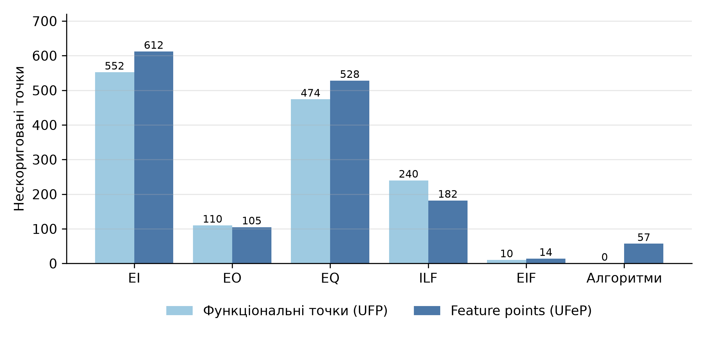
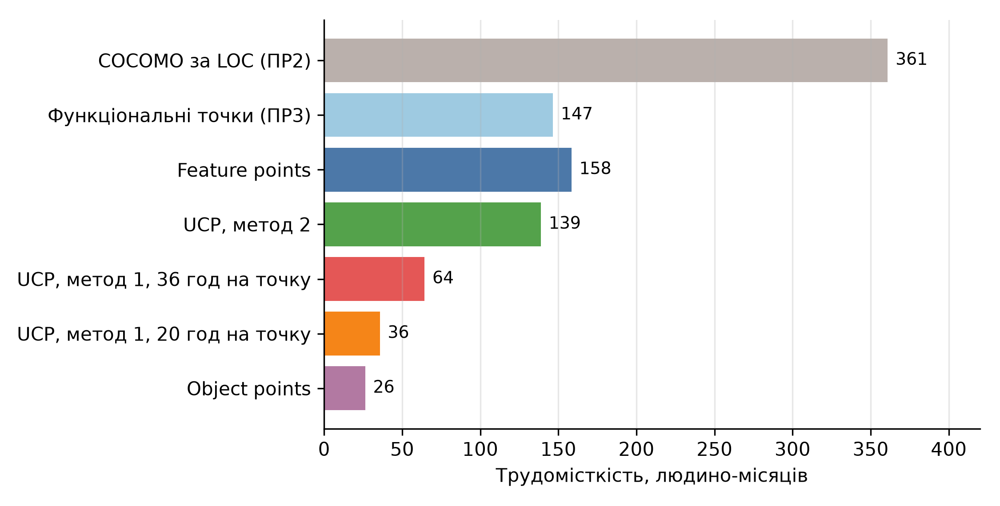

# Мета роботи

Навчитися оцінювати розмір програмного забезпечення шляхом застосування додаткових видів точок, а саме Feature points, Object points та Use-case points.

# Завдання

1. Використовуючи власні або запропоновані викладачем програмні застосунки обчислити наступне: кількість Feature points; кількість Object Points; кількість Use-case points за першим і другим методами.
2. Визначити економічний вплив отриманих результатів на реалізацію програмного застосунка.

# 1. Вихідні дані

Оцінку виконано для застосунку Shopizer, який розглядався в практичних роботах № 2 і № 3 [1]. З них використано:

- кількість компонентів функціональних точок: 153 зовнішні входи (EI), 21 зовнішній вихід (EO), 132 зовнішні запити (EQ), 26 внутрішніх логічних файлів (ILF), 2 зовнішні інтерфейсні файли (EIF);
- нормуючий фактор $VAF = 1.10$ і $AFP = 1\,520$ для функціональних точок;
- розмір 72.0 KLOC і трудомісткість 360.9 людино-місяців за COCOMO;
- зарплата \$2 500 на місяць (медіана Middle, усі мови, DOU літо 2026) [2] і курс НБУ 45.666 грн за долар [3].

Одиницями вимірювання в розділах 2–5 є точки відповідного виду, а в розділі 6 їх переведено в трудомісткість і вартість.

# 2. Feature points

## 2.1. Метод

Feature points запропонував Джонс як розширення функціональних точок для систем із значною внутрішньою обробкою, у яких функціональність, не видима користувачу, не враховується звичайним підрахунком [4]. До п'яти компонентів IFPUG додається шостий – алгоритми, а ваги змінено: внутрішні логічні файли і зовнішні інтерфейси мають вагу 7 (у IFPUG 10 і 7), вхід і запит – 4, вихід – 5, алгоритм – 3. Ваги взято за Джонсом [4]; в [5] їх переказано у вигляді формули:

$$UFeP = 4 \cdot EI + 5 \cdot EO + 4 \cdot EQ + 7 \cdot ILF + 7 \cdot EIF + 3 \cdot ALG.$$

Для всіх компонентів береться одна вага, складність не розрізняється. Нормуючий фактор обчислюється так само, як для функціональних точок, за 14 загальними характеристиками, тому використано $VAF = 1.10$ з практичної роботи № 3:

$$AFeP = UFeP \cdot VAF.$$

## 2.2. Алгоритми

Алгоритмом вважається обмежена обчислювальна задача зі своїм способом розв'язання, яка виконується в межах застосунку, але користувач її безпосередньо не бачить. У вихідному коді виділено 19 алгоритмів (таблиця 1). Кожен знайдено за ім'ям класу або методу, і всі вони існують у коді.

Таблиця 1 – Алгоритми Shopizer

| № | Алгоритм | Клас або метод |
| ----- | ------------------------------------ | ----------------------------------------------------------- |
| 1 | Остаточна ціна товару (знижки, атрибути, клієнт) | Pricing​Service​Impl.calculate​Product​Price |
| 2 | Підсумок кошика | Shopping​Cart​Calculation​Service​Impl.calculate |
| 3 | Підсумок замовлення | Order​Service​Impl.calculate​Shopping​Cart​Total |
| 4 | Розрахунок податків | Tax​Service​Impl.calculate​Tax |
| 5 | Вартість доставки за вагою | Custom​Weight​Based​Shipping​Quote |
| 6 | Вартість доставки за відстанню | Price​By​Distance​Shipping​Quote​Rules |
| 7 | Вартість доставки за правилами | Custom​Shipping​Quote​Rules, Shipping​Decision​Pre​Processor​Impl |
| 8 | Пакування товарів у коробки | Default​Packaging​Impl |
| 9 | Запит і розбір відповіді UPS | UPSShipping​Quote |
| 10 | Запит і розбір відповіді USPS | USPSShipping​Quote |
| 11 | Знижка за промокодом | Promo​Code​Calculator​Module |
| 12 | Правила коду доставки виробника | Manufacturer​Shipping​Code​Order​Total​Module​Impl |
| 13 | Шифрування і дешифрування даних | Encryption​Impl |
| 14 | Генерація і перевірка токена JWT | JWTToken​Util |
| 15 | Перевірка і генерація пароля | Credentials​Service​Impl |
| 16 | Перевірка номера кредитної картки | Payment​Service​Impl.validate​Credit​Card​Number |
| 17 | Масштабування зображень | Product​Image​Size​Utils |
| 18 | Середній рейтинг відгуків | Product​Review​Service​Impl, Customer​Review​Service​Impl |
| 19 | Індексація і повнотекстовий пошук | Search​Service​Impl |

## 2.3. Розрахунок

Кількість елементів: $EI = 153$, $EO = 21$, $EQ = 132$, $ILF = 26$, $EIF = 2$, $ALG = 19$.

$$UFeP = 4 \cdot 153 + 5 \cdot 21 + 4 \cdot 132 + 7 \cdot 26 + 7 \cdot 2 + 3 \cdot 19 = 612 + 105 + 528 + 182 + 14 + 57 = 1\,498,$$

$$AFeP = 1\,498 \cdot 1.10 = 1\,647.8 \approx 1\,648.$$

Алгоритми дають 57 точок (3.8%). Вага алгоритму змінюється від 1 до 10, за замовчуванням 3 [4]. За мінімальної ваги 1 для всіх алгоритмів $UFeP = 1\,460$, за максимальної 10 – 1 631, тобто результат змінюється в межах від −2.5% до +8.9%.

Порівняння з нескоригованими функціональними точками ($UFP = 1\,386$, практична робота № 3) наведено на рисунку 1. Feature points на 8.1% більше. Файли дають менше (196 проти 250), а входи і запити більше (1 140 проти 1 026), бо в Feature points їхня вага 4 вища за фактичну середню 3.6 у функціональних точках. Оскільки в застосунку переважають транзакції, а не дані, перевага входів і запитів більша за втрату на файлах.

{width=15cm}

Рисунок 1 – Feature points і функціональні точки за компонентами

# 3. Object points

## 3.1. Метод

Object points – метрика моделі композиції застосунку з COCOMO II, що орієнтована на проєкти, створювані з готових компонентів і засобів швидкої розробки. Підраховуються екрани, звіти і компоненти на мові третього покоління (3GL). Складність екрана визначають за кількістю представлень і таблиць даних, складність звіту – за кількістю розділів і таблиць. Ваги: екран 1, 2 або 3 (простий, середній, складний), звіт 2, 5 або 8, компонент 3GL – 10 [6]. Нова кількість об'єктних одиниць враховує частку повторно використаних об'єктів $r$, а трудомісткість визначається продуктивністю $PROD$:

$$NOP = OP \cdot \frac{100 - r}{100},\qquad Effort = \frac{NOP}{PROD}.$$

Значення $PROD$ за рівнем досвіду команди і зрілості середовища: 4, 7, 13, 25 і 50 для дуже низького, низького, номінального, високого і дуже високого рівнів [6].

## 3.2. Застосування до серверної частини

Shopizer не має власного графічного інтерфейсу: вітрина і адміністративна панель є окремими застосунками, а продуктом виступає REST API. Тому прийнято такі відповідності:

1. Екраном вважається ресурс API, тобто контролер: його транзакції є представленнями (views), а файли, до яких він звертається, – таблицями даних. 54 контролери дають 54 екрани.
2. Звітами вважаються документи, які застосунок формує: 20 шаблонів листів і рахунок-фактура (ODS). Усі мають один-три розділи і менше чотирьох таблиць, тому є простими.
3. Компонентами 3GL вважаються модулі інтеграції і розрахунку на Java, які не можна замінити настроюванням: модулі оплати, доставки, пошти, сховищ файлів, підсумку замовлення, рахунку-фактури, шифрування.

Складність екрана: за менше ніж трьох представлень і менше ніж чотирьох таблиць – простий, за 3–7 представлень і 4–7 таблиць – середній і так далі за матрицею [6]. Складність кожного екрана наведено в додатку А.

## 3.3. Розрахунок

Із 54 екранів 39 простих, 13 середніх і 2 складних, тобто $39 \cdot 1 + 13 \cdot 2 + 2 \cdot 3 = 71$ точка. Компоненти 3GL наведено в таблиці 2.

Таблиця 2 – Компоненти 3GL

| Компоненти | Кількість | Бали |
| ---------------------------------------------------------------------- | -------------- | -------------- |
| Модулі оплати (BeanStream, Braintree, MoneyOrder, PayPal Express, PayPal REST, Stripe, Stripe3) | 7 | 70 |
| Модулі доставки (UPS, USPS, за вагою, за відстанню, за правилами, самовивіз) | 6 | 60 |
| Відправлення пошти (SMTP, AWS SES) | 2 | 20 |
| Сховища файлів (локальне, AWS S3, GCP, Infinispan) | 4 | 40 |
| Модулі підсумку замовлення (промокод, код доставки виробника) | 2 | 20 |
| Формування рахунку-фактури (ODS) | 1 | 10 |
| Шифрування | 1 | 10 |
| Разом | 23 | 230 |

Звіти дають $21 \cdot 2 = 42$ точки, екрани – 71, компоненти 3GL – 230. Разом

$$OP = 71 + 42 + 230 = 343.$$

Частку повторного використання не враховано ($r = 0$), тому $NOP = 343$. Трудомісткість за номінальної продуктивності $PROD = 13$:

$$Effort = 343 / 13 = 26.4\ \text{людино-місяця}.$$

Для інших рівнів продуктивності: 85.8 (дуже низький, $PROD = 4$), 49.0 (низький), 13.7 (високий), 6.9 (дуже високий).

# 4. Use-case points, перший метод

## 4.1. Метод

Метод Карнера рахує розмір за варіантами використання [7]. Ваги акторів: простий (інша система з визначеним API) – 1, середній (інша система за протоколом) – 2, складний (особа з графічним інтерфейсом) – 3. Ваги варіантів використання за кількістю транзакцій: до трьох – 5, від чотирьох до семи – 10, понад сім – 15.

$$UUCP = UAW + UUCW,\qquad UCP = UUCP \cdot TCF \cdot EF,$$

$$TCF = 0.6 + 0.01 \cdot TFactor,\qquad EF = 1.4 - 0.03 \cdot EFactor.$$

Фактори оцінюються від 0 до 5 і множаться на ваги: 13 технічних факторів і 8 факторів середовища [7].

## 4.2. Актори

Акторами є 4 ролі користувачів, які визначені в коді (CUSTOMER, SUPERADMIN, ADMIN, ADMIN_STORE, ADMIN_CATALOGUE, ADMIN_ORDER, ADMIN_RETAILER), і 5 зовнішніх систем (таблиця 3). Ролі адміністраторів магазину об'єднано в одного актора.

Таблиця 3 – Актори

| Актор | Тип | Вага |
| ------------------------------------------------------------ | ------------------------------ | -------- |
| Покупець (роль CUSTOMER) | Складний | 3 |
| Адміністратор магазину (ADMIN, ADMIN_STORE, ADMIN_CATALOGUE, ADMIN_ORDER) | Складний | 3 |
| Адміністратор роздрібного продавця (ADMIN_RETAILER) | Складний | 3 |
| Суперадміністратор (SUPERADMIN) | Складний | 3 |
| Платіжний шлюз | Простий | 1 |
| Служба доставки UPS | Простий | 1 |
| Служба доставки USPS | Простий | 1 |
| Поштовий сервер | Середній | 2 |
| Хмарне сховище файлів | Простий | 1 |
| Разом (UAW) |  | 18 |

## 4.3. Варіанти використання

Транзакції з практичної роботи № 3 згруповано в 22 варіанти використання. Як транзакція використання береться унікальна операція: версії API v1 і v2 і шляхи /private і /auth одного методу рахуються один раз, тому кількість транзакцій менша за 306 (таблиця 4).

Таблиця 4 – Варіанти використання

| № | Варіант використання | Транзакцій | Складність | Вага |
| ----- | -------------------------------------------------- | -------------- | ---------------- | -------- |
| 1 | Автентифікація і відновлення пароля клієнта | 7 | Середній | 10 |
| 2 | Керування профілем клієнта | 13 | Складний | 15 |
| 3 | Перегляд товарів і категорій | 28 | Складний | 15 |
| 4 | Пошук товарів | 3 | Простий | 5 |
| 5 | Відгуки про товари і клієнтів | 8 | Складний | 15 |
| 6 | Керування кошиком | 9 | Складний | 15 |
| 7 | Розрахунок підсумку замовлення | 1 | Простий | 5 |
| 8 | Розрахунок вартості доставки | 2 | Простий | 5 |
| 9 | Оплата замовлення | 10 | Складний | 15 |
| 10 | Оформлення і перегляд замовлень | 8 | Складний | 15 |
| 11 | Керування каталогом і категоріями | 9 | Складний | 15 |
| 12 | Керування варіантами товару | 21 | Складний | 15 |
| 13 | Керування опціями товару | 26 | Складний | 15 |
| 14 | Керування зображеннями товару | 9 | Складний | 15 |
| 15 | Керування типами, виробниками і групами | 26 | Складний | 15 |
| 16 | Керування контентом і файлами | 31 | Складний | 15 |
| 17 | Керування магазином | 21 | Складний | 15 |
| 18 | Керування користувачами і правами | 17 | Складний | 15 |
| 19 | Налаштування доставки | 13 | Складний | 15 |
| 20 | Керування податками | 12 | Складний | 15 |
| 21 | Керування модулями, конфігурацією і кешем | 10 | Складний | 15 |
| 22 | Довідники | 5 | Середній | 10 |
|  | Разом (UUCW) |  |  | 290 |

Три варіанти прості, два середні, 17 складні: $UUCW = 3 \cdot 5 + 2 \cdot 10 + 17 \cdot 15 = 290$. $UUCP = 18 + 290 = 308$.

## 4.4. Фактори

Оцінки факторів експертні, за вихідним кодом і конфігурацією (таблиці 5 і 6). Склад команди Shopizer невідомий, тому фактори середовища, які описують команду (F1, F4, F5, F7), прийнято на середньому рівні, а F2, F3, F6 і F8 оцінено за вихідним кодом і історією проєкту.

Таблиця 5 – Технічні фактори

| Фактор | Вага | Оцінка | Добуток | Обґрунтування |
| ---------------------------- | --------- | ----------- | ------------ | ---------------------------------------------- |
| T1 Розподілена система | 2 | 3 | 6.0 | серверна частина відокремлена від вітрини, адмінки, кешу і сховищ |
| T2 Час відгуку | 2 | 2 | 4.0 | кешування є, жорстких вимог немає |
| T3 Ефективність роботи користувача | 1 | 3 | 3.0 | кілька мов і валют, повідомлення валідації |
| T4 Складна внутрішня обробка | 1 | 4 | 4.0 | ціни, податки, доставка, пакування |
| T5 Повторне використання коду | 1 | 3 | 3.0 | модулі оплати і доставки замінні |
| T6 Зручність встановлення | 0.5 | 3 | 1.5 | Maven, Docker, схема бази створюється автоматично |
| T7 Зручність використання | 0.5 | 3 | 1.5 | документація Swagger для клієнтів API |
| T8 Переносимість | 2 | 4 | 8.0 | Java, кілька СУБД і сховищ |
| T9 Зручність змін | 1 | 3 | 3.0 | налаштовувані атрибути і модулі |
| T10 Паралельність | 1 | 3 | 3.0 | багатокористувацький веб-сервіс |
| T11 Безпека | 1 | 5 | 5.0 | JWT, ролі, шифрування даних |
| T12 Доступ третіх сторін | 1 | 5 | 5.0 | відкритий API для вітрин і інтеграцій |
| T13 Спеціальне навчання користувачів | 1 | 1 | 1.0 | навчання потрібне лише розробникам клієнтів API |
| Разом (TFactor) |  |  | 48.0 |  |

Таблиця 6 – Фактори середовища

| Фактор | Вага | Оцінка | Добуток | Обґрунтування |
| ---------------------------- | --------- | ----------- | ------------ | ---------------------------------------------- |
| F1 Знайомство з процесом розробки | 1.5 | 3 | 4.5 | склад команди невідомий, прийнято середній рівень |
| F2 Досвід у предметній області | 0.5 | 4 | 2.0 | електронна комерція, проєкт існує з 2012 року |
| F3 Досвід в ООП | 1 | 5 | 5.0 | Java |
| F4 Здібності провідного аналітика | 0.5 | 3 | 1.5 | прийнято середній рівень |
| F5 Мотивація | 1 | 3 | 3.0 | прийнято середній рівень |
| F6 Стабільність вимог | 2 | 3 | 6.0 | зрілий продукт, але є версії API v1 і v2 |
| F7 Частково зайняті працівники | -1 | 3 | -3.0 | відкритий проєкт, прийнято середній рівень |
| F8 Складна мова програмування | -1 | 1 | -1.0 | Java |
| Разом (EFactor) |  |  | 18.0 |  |

$TFactor = 48.0$, $TCF = 0.6 + 0.01 \cdot 48.0 = 1.08$. $EFactor = 18.0$, $EF = 1.4 - 0.03 \cdot 18.0 = 0.86$.

## 4.5. Розрахунок

$$UCP = 308 \cdot 1.08 \cdot 0.86 = 286.1.$$

Трудомісткість у годинах – $UCP$ помножене на кількість людино-годин на точку: за Карнером 20, за літературою до 36 [7]. Це 5 721 і 10 299 годин. За 160 робочих годин на місяць трудомісткість становить 35.8 і 64.4 людино-місяці.

Чутливість до дрібності варіантів використання. Якщо замість 22 об'єднаних варіантів узяти по одному на контролер (54 варіанти: 22 прості, 20 середніх, 12 складних), $UUCW = 490$, $UCP = 471.8$, трудомісткість за 20 годин на точку становить 59.0 людино-місяців, що в 1.6 раза більше.

# 5. Use-case points, другий метод

За другим методом розмір підраховується як для функціональних точок, але за діаграмами варіантів використання: з кожного варіанта виділяються входи, виходи і запити. Для цього застосовано ті самі варіанти використання з розділу 4, а транзакціями вважаються їхні унікальні операції (версії API і псевдоніми шляхів не дублюються). Файли взято з практичної роботи № 3. Діаграми варіантів використання і діяльності UML не будувались: єдина відмінність від практичної роботи № 3 – у 17 транзакціях менше (289 замість 306), бо версії API і псевдоніми шляхів не дублюються.

Унікальних операцій 289: 146 входів, 20 виходів і 123 запити. Їхня складність і вага визначені так само, як у практичній роботі № 3. Транзакції дають 1 063 нескоригованих точок, файли – 250, разом

$$UFP = 1\,063 + 250 = 1\,313,\qquad AFP = 1\,313 \cdot 1.10 = 1\,444.3 \approx 1\,444.$$

Це на 5.3% менше, ніж 1 525 за підрахунком за кодом. Різниця пояснюється тим, що 17 транзакцій за кодом (псевдоніми і дублікати версій) за варіантами використання об'єднуються.

# 6. Економічний вплив

Трудомісткість і вартість за різними видами точок наведено в таблиці 7 і на рисунку 2. Feature points, функціональні точки і метод 2 для Use-case points переведено в трудомісткість за продуктивністю Java 10.4 FP на людино-місяць [8]. Use-case points – за Карнером, Object points – за моделлю COCOMO II. Зарплата \$2 500 на місяць [2], курс 45.666 грн за долар [3].

Таблиця 7 – Оцінка трудомісткості і вартості

| Метод | Розмір | Трудомісткість, людино-місяців | Вартість, \$ | Вартість, млн грн |
| ---------------------------------- | -------------------- | ---------------------- | ---------------- | ---------------- |
| COCOMO за LOC (ПР2) | 72.0 KLOC | 360.9 | 902 364 | 41.2 |
| Функціональні точки (ПР3) | AFP = 1 525 | 146.6 | 366 490 | 16.7 |
| Feature points | AFeP = 1 648 | 158.4 | 396 106 | 18.1 |
| Use-case points, метод 2 | AFP = 1 444 | 138.9 | 347 188 | 15.9 |
| Use-case points, метод 1, 20 год | UCP = 286 | 35.8 | 89 397 | 4.1 |
| Use-case points, метод 1, 36 год | UCP = 286 | 64.4 | 160 915 | 7.3 |
| Object points, номінальна продуктивність | OP = 343 | 26.4 | 65 962 | 3.0 |

{width=15cm}

Рисунок 2 – Оцінки трудомісткості за різними методами

Оцінки утворюють дві групи. Feature points (158.4), функціональні точки (146.6) і другий метод Use-case points (138.9) дають 139–158 людино-місяців, \$347–396 тисяч. Це розбіжність у межах 14%, бо всі три методи рахують однакові транзакції і файли. За COCOMO від кількості рядків трудомісткість у 2.3–2.6 раза більша (360.9).

Use-case points за першим методом (36–64 людино-місяці) і Object points (26 людино-місяців) дають значно менші оцінки, у 2.2–6.0 раза нижче за точки з транзакціями. Причини розглянуто в розділі 7.

Для планування реалізації застосунка достатньо брати діапазон 140–360 людино-місяців, тобто \$350–900 тисяч, з нижньою межею за точками, які мають транзакції, і верхньою за COCOMO. Оцінки Object points і першого методу Use-case points як основу бюджету використовувати не варто.

# 7. Аналіз результатів і верифікація

Порівняння методів:

1. Feature points / функціональні точки = 1 498 / 1 386 = 1.081. Різниця 112 точок складається з входів (+60), запитів (+54), алгоритмів (+57), виходів (−5) і файлів (−54).
2. Use-case points за методом 2 / функціональні точки = 1 444 / 1 525 = 0.947. Обидва підрахунки використовують одні й ті самі правила, відрізняється лише кількість унікальних операцій.
3. Use-case points за методом 1 дають 286.1 при 22 варіантах використання, а при 54 – 471.8. Результат залежить від рівня деталізації варіантів, бо вага одного варіанта обмежена 15 точками, тому для великої системи метод недооцінює розмір. Тому метод придатний для систем, де варіант використання охоплює невелику кількість транзакцій.
4. Object points орієнтовані на проєкти зі швидкою розробкою з готових компонентів: PROD від 4 до 50 охоплює діапазон 6.9–85.8 людино-місяців, тобто різницю у 12 разів. Для серверного застосунку, який не має екранів, розмір визначається переважно компонентами 3GL (67% точок), тому метод не відображає обсяг роботи над бізнес-логікою.

Перевірка вихідних даних. Усі 19 алгоритмів знайдено в коді за іменем класу, а методи, що наведені в таблиці 1 (calculateProductPrice, calculateTax, validateCreditCardNumber), існують. Кількість модулів оплати (7) і доставки (6) збігається з кількістю класів у каталозі модулів. Підсумки екранів, звітів і компонентів сумуються до 343 (71 + 42 + 230), а ваги варіантів використання – до 290.

Обмеження:

1. Виділення алгоритмів і варіантів використання виконано вручну за вихідним кодом. Інший аналітик міг би виділити іншу кількість, особливо алгоритмів (вага яких в діапазоні 1–10).
2. Відповідність ресурсів API екранам для Object points прийнята за припущенням, бо Shopizer має лише серверну частину.
3. Фактори Use-case points експертні. Зміна $TFactor$ на 1 змінює $TCF$ на 0.01, тобто результат на 0.9%.
4. Переведення Feature points у трудомісткість за продуктивністю функціональних точок наближене, бо власних даних про продуктивність для Feature points немає.
5. Склад і досвід команди Shopizer невідомі, тому фактори, що описують команду (F1, F4, F5, F7), прийнято на середньому рівні; решту факторів середовища оцінено за кодом, і вони впливають на результат.

# Висновки

У роботі виконано оцінку розміру Shopizer за трьома додатковими видами точок.

1. Feature points: $UFeP = 1\,498$, $AFeP = 1\,648$ (19 алгоритмів, 57 точок). Вони на 8.1% більші за функціональні точки, а вплив ваги алгоритмів на результат становить від −2.5% до +8.9%.
2. Object points: $OP = 343$ (71 від екранів, 42 від звітів, 230 від компонентів 3GL). Трудомісткість – від 6.9 до 85.8 людино-місяців залежно від продуктивності, 26.4 за номінальної.
3. Use-case points: за першим методом $UCP = 286.1$ (22 варіанти використання, $UAW = 18$, $UUCW = 290$, $TCF = 1.08$, $EF = 0.86$), за другим – $AFP = 1\,444$, що на 5.3% менше за підрахунок за кодом.
4. Економічний вплив: Feature points і другий метод Use-case points дають 139–158 людино-місяців (\$347–396 тис.), як і функціональні точки з практичної роботи № 3. Перший метод Use-case points і Object points дають 26–64 людино-місяці і для оцінки великого серверного застосунку непридатні. Практична оцінка укладається в діапазон 140–360 людино-місяців, \$350–900 тисяч.

# Список джерел

1. Shopizer: Java open source e-commerce software. URL: https://github.com/shopizer-ecommerce/shopizer, коміт 6a4a0a6 від 23.03.2025 (дата звернення: 04.11.2026).
2. Зарплати українських розробників – літо 2026. DOU. 13.07.2026. URL: https://dou.ua/lenta/articles/salary-report-devs-summer-2026/ (дата звернення: 04.11.2026).
3. Офіційний курс гривні щодо іноземних валют на 04.11.2026: долар США 45.666 UAH. Національний банк України. URL: https://bank.gov.ua/NBUStatService/v1/statdirectory/exchange?valcode=USD&date=20261104&json (дата звернення: 04.11.2026).
4. Jones C. Applied Software Measurement: Assuring Productivity and Quality. New York : McGraw-Hill, 1991. 493 p.
5. Extended Function Point (EFP) Metrics. GeeksforGeeks. URL: https://www.geeksforgeeks.org/software-engineering/extended-function-point-efp-metrics/ (дата звернення: 04.11.2026).
6. Boehm B. W., Abts C., Brown A. W. et al. Software Cost Estimation with COCOMO II. Upper Saddle River, NJ : Prentice Hall, 2000. 544 p.
7. Anda B., Benestad H. C., Hove S. E. A Multiple-Case Study of Software Effort Estimation based on Use Case Points. 2005 International Symposium on Empirical Software Engineering (ISESE). IEEE, 2005. URL: https://people.eecs.ku.edu/~hossein/811/Papers/Use-Case-Points/use-case-points-anda.pdf (дата звернення: 04.11.2026).
8. Jones C. Software Economics and Function Point Metrics: Thirty years of IFPUG Progress, версія 10.0. Namcook Analytics, 14.04.2017. URL: https://www.ifpug.org/wp-content/uploads/2017/04/IYSM.-Thirty-years-of-IFPUG.-Software-Economics-and-Function-Point-Metrics-Capers-Jones.pdf (дата звернення: 04.11.2026).

# Додаток А. Екрани для підрахунку Object points

Таблиця А.1 – Екрани для підрахунку Object points

| № | Контролер | Представлення | Таблиці | Складність | Бали |
| ------ | ------------------------------ | -------------------- | ------------ | ---------------- | -------- |
| 1 | AuthenticateCustomerApi | 4 | 1 | Простий | 1 |
| 2 | AuthenticateUserApi | 2 | 1 | Простий | 1 |
| 3 | CacheApi | 1 | 1 | Простий | 1 |
| 4 | CatalogApi | 9 | 2 | Середній | 2 |
| 5 | CategoryApi | 10 | 2 | Середній | 2 |
| 6 | ConfigurationsApi | 3 | 1 | Простий | 1 |
| 7 | ContactApi | 1 | 1 | Простий | 1 |
| 8 | ContentAdministrationApi | 6 | 2 | Простий | 1 |
| 9 | ContentApi | 24 | 1 | Середній | 2 |
| 10 | CustomerApi | 10 | 2 | Середній | 2 |
| 11 | CustomerNewsletterApi | 3 | 2 | Простий | 1 |
| 12 | CustomerReviewApi | 4 | 2 | Простий | 1 |
| 13 | DefaultController | 1 | 0 | Простий | 1 |
| 14 | FilesController | 2 | 2 | Простий | 1 |
| 15 | ImagesController | 4 | 3 | Простий | 1 |
| 16 | MarketPlaceApi | 3 | 2 | Простий | 1 |
| 17 | MerchantStoreApi | 15 | 2 | Середній | 2 |
| 18 | OptinApi | 1 | 1 | Простий | 1 |
| 19 | OrderApi | 9 | 3 | Середній | 2 |
| 20 | OrderPaymentApi | 8 | 5 | Складний | 3 |
| 21 | OrderShippingApi | 2 | 6 | Простий | 1 |
| 22 | OrderStatusHistoryApi | 2 | 1 | Простий | 1 |
| 23 | OrderTotalApi | 2 | 5 | Простий | 1 |
| 24 | PaymentApi | 3 | 3 | Простий | 1 |
| 25 | ProductApi | 10 | 2 | Середній | 2 |
| 26 | ProductApiV2 | 10 | 2 | Середній | 2 |
| 27 | ProductAttributeOptionApi | 20 | 1 | Середній | 2 |
| 28 | ProductGroupApi | 7 | 1 | Простий | 1 |
| 29 | ProductImageApi | 5 | 2 | Простий | 1 |
| 30 | ProductInventoryApi | 5 | 1 | Простий | 1 |
| 31 | ProductManufacturerApi | 8 | 1 | Середній | 2 |
| 32 | ProductPriceApi | 7 | 1 | Простий | 1 |
| 33 | ProductPropertySetApi | 6 | 1 | Простий | 1 |
| 34 | ProductRelationshipApi | 1 | 1 | Простий | 1 |
| 35 | ProductReviewApi | 4 | 2 | Простий | 1 |
| 36 | ProductTypeApi | 6 | 1 | Простий | 1 |
| 37 | ProductVariantApi | 6 | 2 | Простий | 1 |
| 38 | ProductVariantGroupApi | 7 | 2 | Простий | 1 |
| 39 | ProductVariationApi | 8 | 4 | Складний | 3 |
| 40 | PublicConfigsApi | 1 | 1 | Простий | 1 |
| 41 | ReferencesApi | 5 | 2 | Простий | 1 |
| 42 | ResetCustomerPasswordApi | 3 | 1 | Простий | 1 |
| 43 | ResetUserPasswordApi | 3 | 1 | Простий | 1 |
| 44 | SearchApi | 2 | 1 | Простий | 1 |
| 45 | SearchToolsApi | 1 | 2 | Простий | 1 |
| 46 | SecurityApi | 3 | 1 | Простий | 1 |
| 47 | ShippingConfigurationApi | 10 | 2 | Середній | 2 |
| 48 | ShippingExpeditionApi | 3 | 1 | Простий | 1 |
| 49 | ShoppingCartApi | 9 | 3 | Середній | 2 |
| 50 | StoreContactRESTController | 2 | 1 | Простий | 1 |
| 51 | SystemRESTController | 4 | 1 | Простий | 1 |
| 52 | TaxClassApi | 6 | 1 | Простий | 1 |
| 53 | TaxRatesApi | 6 | 1 | Простий | 1 |
| 54 | UserApi | 9 | 1 | Середній | 2 |
