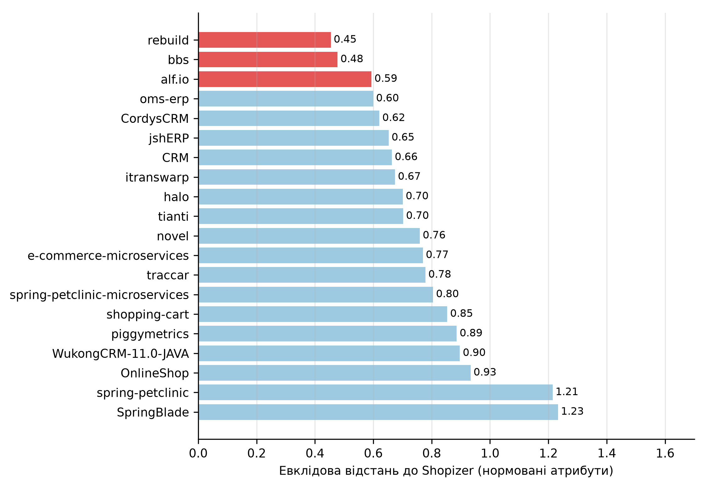
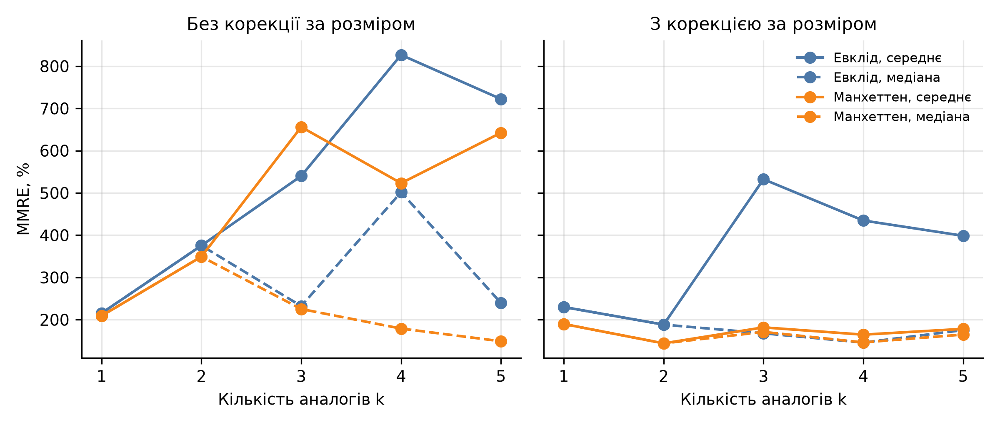

# Мета роботи

Навчитися здійснювати оцінку проєкту за рахунок використання методу аналогій.

# Завдання

1. Вибрати проєкти та створити базу даних проєктів. Навести посилання на вибрані проєкти.
2. Вибрати проєкт, який відкладаємо в сторону, – він буде як «новий проєкт», що використовується для оцінки зусиль проєкту програмного забезпечення за аналогією.
3. Визначити необхідні для застосування методу аналогії атрибути (характеристики) «нового проєкту», не враховувати в ці атрибути розмір, зусилля та мову програмування проєкту. Обчислити значення відповідних характеристик для всіх проєктів.
4. Внести всі дані у власний набір даних. Застосовуючи одну або декілька метрик відстані, обчислити відстані усіх проєктів до «нового» проєкту. Виявити три найближчі проєкти.
5. Оцінити економічні показники нового проєкту. При оцінці враховувати мову програмування аналогічних проєктів.

# 1. Метод і джерела даних

Метод аналогії оцінює зусилля нового проєкту за зусиллями завершених проєктів, найближчих до нього за атрибутами. Відстань між проєктами обчислюється за нормованими значеннями атрибутів, оцінка – середнє або медіана зусиль $k$ найближчих проєктів, за потреби скориговане за розміром [@Shepperd1997]. Параметри, які можна калібрувати: метрика відстані, кількість аналогів $k$, набір атрибутів, статистика і корекція за розміром.

Як «новий» проєкт обрано Shopizer, застосунок з практичних робіт № 2–4 [@Shopizer]. Тоді оцінку можна порівняти з результатами попередніх робіт. Для нього відомий розмір, але реальні зусилля невідомі, тому їх оцінюємо за аналогами. У цій роботі розмір Shopizer, як і розміри аналогів, рахується за всіма Java-файлами, включно з тестами (75.6 KLOC); у практичній роботі № 2 для COCOMO використано лише основний код (72.0 KLOC), тому цифри різняться, а підхід до аналогів однаковий.

Як аналоги взято 20 відкритих Java-проєктів з GitHub, які є бізнес-застосунками з серверною частиною: ERP і CRM, інтернет-магазини, системи керування контентом, форуми, бронювання квитків. Усі вони написані на Java, як і новий проєкт, тому мова не коригується. Вибір виконано так: з 30 кандидатів, знайдених за темами e-commerce, erp, crm, cms, inventory-management, point-of-sale та іншими, відібрано проєкти, які мають не менше 1.8 тисячі рядків коду Java, 20 комітів і не менше 5 людино-місяців активності (пар «автор, місяць», див. розділ 2) та хоча б одну структурну ознаку (модуль, ендпоінт або Spring-компонент). Цим критеріям відповіли рівно 20 з 30 кандидатів, тому «відбір» фактично залишив усі проєкти, що їх пройшли. Серед них є три навчальні проєкти (spring-petclinic, його мікросервісна версія, piggymetrics) і кілька проєктів зі слабкою історією комітів; вплив цих груп перевірено у розділі 6.

Проєкти зібрано так: клонування репозиторію на актуальний коміт, підрахунок рядків cloc [@Cloc], підрахунок атрибутів за вихідним кодом і підрахунок зусиль за історією комітів.

# 2. База даних проєктів

Розмір проєкту – кількість рядків коду Java (cloc) на зафіксованому коміті, у тисячах (KLOC).

Зусилля. Реальні трудовитрати відкритих проєктів невідомі, тому як їх наближення прийнято кількість людино-місяців активності: пар «автор, календарний місяць», у яких автор зробив хоча б один коміт. Це оцінка зверху для окремих розробників, які пишуть код епізодично, і оцінка знизу для робіт без комітів (тестування, документація, керування). Така міра є грубою, тому точність результатів у розділі 6 нижча, ніж на вибірках із фактично виміряними зусиллями. Одиниця зусиль – людино-місяць активності.

Таблиця 1 – База даних проєктів (розмір і зусилля)

<!-- TABLE_DB -->

Таблиці 1 і 2 разом утворюють базу даних проєктів: перша містить посилання, коміт, мову, розмір і зусилля, друга – атрибути для порівняння; повна таблиця збережена у файлі database.csv.

# 3. Атрибути проєктів

Для порівняння взято 6 атрибутів, які можна визначити за вихідним кодом, без розміру, зусиль і мови:

1. Кількість збірних модулів – файлів pom.xml і build.gradle.
2. Кількість залежностей, оголошених у файлах збірки.
3. Частка тестового коду серед рядків коду Java, %.
4. Частка рядків коментарів до рядків коду, %.
5. Кількість Spring-компонентів: класів з анотаціями Service, Component, Repository, Controller, RestController, Configuration.
6. Кількість ендпоінтів: анотацій GetMapping, PostMapping, PutMapping, DeleteMapping, PatchMapping і RequestMapping.

Атрибути 1 і 2 характеризують структуру і залежності, 3 і 4 – якість супроводу, 5 і 6 – обсяг функціональності. Перший і другий атрибути, а також кількість ендпоінтів можна порівняти з компонентами функціональних точок з практичної роботи № 3. Значення наведено в таблиці 2. Кількість ендпоінтів рахується за анотаціями (як на рівні класу, так і методу), тому вона вища за кількість транзакцій з практичної роботи № 3 (370 проти 306 для Shopizer). Модулі рахуються за всіма pom.xml і build.gradle, включно з батьківським, тому для Shopizer їх 6, тоді як у практичній роботі № 2 згадано п'ять модулів.

Таблиця 2 – Атрибути проєктів

<!-- TABLE_ATTR -->

# 4. Відстані до нового проєкту

Атрибути нормовано до діапазону від 0 до 1 за мінімумом і максимумом серед 21 проєкту (20 аналогів і Shopizer; під час перехресної перевірки діапазон включає і виключений проєкт, що є невеликим витоком інформації):

$$x' = \frac{x - x_{min}}{x_{max} - x_{min}}.$$

Відстань обчислено двома метриками: евклідовою і манхеттенською,

$$d_E = \sqrt{\sum_{i=1}^{k} (x'_i - y'_i)^2},\qquad d_M = \sum_{i=1}^{k} |x'_i - y'_i|,$$

де $x'$, $y'$ – нормовані атрибути нового і порівнюваного проєктів, $k = 6$.

Результати за зростанням евклідової відстані наведено в таблиці 3 і на рисунку 1; рядки трьох найближчих проєктів за кожною метрикою виділено жирним. Найближчі три проєкти за Евклідом: rebuild (0.454), bbs (0.477) і alf.io (0.594). За Манхеттеном найближчі oms-erp (0.938), rebuild (1.000) і bbs (1.070).

Таблиця 3 – Відстані до Shopizer

<!-- TABLE_DIST -->

{width=15cm}

Рисунок 1 – Евклідові відстані до нового проєкту (найближчі три позначено червоним)

Усі три найближчі проєкти за Евклідом мають розмір 71–83 KLOC, тобто відповідають розміру Shopizer (75.6 KLOC), хоча розмір як атрибут не використовувався.

# 5. Оцінка нового проєкту

Оцінка зусиль – середнє зусиль трьох найближчих проєктів. Для корекції за розміром зусилля кожного аналога множиться на відношення розмірів:

$$E_{est} = \frac{1}{k}\sum_{i=1}^{k} E_i \cdot \frac{S_{new}}{S_i},$$

де $E_i$, $S_i$ – зусилля і розмір аналога, $S_{new} = 75.6$ KLOC [@Shepperd1997].

За Евклідом найближчі rebuild (206 людино-місяців), bbs (43) і alf.io (386):

$$E_{est} = (206 + 43 + 386) / 3 = 211.7\ \text{людино-місяця}.$$

З корекцією за розміром оцінка 204.6. За Манхеттеном найближчі oms-erp (20), rebuild (206) і bbs (43), оцінка 89.7, а з корекцією 98.2. Вартість – зусилля, помножене на зарплату \$2 500 на місяць (медіана Middle, усі мови, DOU літо 2026) [@DOU2026], у гривнях за курсом НБУ 45.666 грн за долар [@NBU]. Результати в таблиці 4.

Таблиця 4 – Оцінки зусиль і вартості Shopizer

<!-- TABLE_EST -->

Оцінки відрізняються у 2.4 раза (89.7–211.7 людино-місяця): розбіжність зумовлена переважно різницею між проєктами oms-erp (20 людино-місяців при 47.2 KLOC) і alf.io (386 при 83.1 KLOC).

# 6. Калібрування і верифікація

Для оцінки точності кожен із 20 проєктів по черзі виключався з бази і оцінювався за рештою (перехресна перевірка), після чого порівнювалось з відомими зусиллями. Показники: відносна похибка $MRE = |E_{est} - E| / E$, її середнє MMRE, медіана MdMRE і частка проєктів з похибкою не більшою за 25% і 50%, Pred(25) і Pred(50) [@Conte1986]. Для кожної з 40 конфігурацій (дві метрики, $k$ від 1 до 5, середнє або медіана, з корекцією за розміром або без) обчислено ці показники. У таблиці 5 і на рисунку 2 наведено 20 конфігурацій зі статистикою «середнє»; конфігурації з медіаною обчислено в програмі (analogy.json) і в таблицю не включено. Нормування в кожному кроці перехресної перевірки використовує діапазони з усіх проєктів, включно з виключеним.

Таблиця 5 – Результати перехресної перевірки

<!-- TABLE_CALIB -->

{width=16cm}

Рисунок 2 – Залежність MMRE від кількості аналогів

Висновки з перехресної перевірки:

1. Точність низька для всіх конфігурацій: найкраще значення MMRE – 144%, Pred(25) не перевищує 35%. Звичайно прийнятним вважається MMRE до 25% і Pred(25) від 75%.
2. Корекція за розміром покращує результат у більшості конфігурацій: для Манхеттена MMRE зменшується з 209–656% до 144–190%, для Евкліда (середнє за п'ятьма значеннями $k$) з 536% до 357%. Без корекції дрібні проєкти (2–3 KLOC) із великими зусиллями (spring-petclinic, 169 і 359 людино-місяців) спотворюють оцінку.
3. Найкраща за MMRE конфігурація – Манхеттен, $k = 2$, середнє з корекцією за розміром (MMRE 144%, MdMRE 62%, Pred(25) лише 10%). Вона дає 125.8 людино-місяця, порядку \$314 тис. (14.4 млн грн) на основі oms-erp і rebuild. Це мінімум, знайдений серед 40 конфігурацій на тих самих 20 проєктах, тобто оптимістична оцінка точності без незалежної перевірки; оцінка спирається лише на два аналоги, один із яких (oms-erp, 20 людино-місяців при 47 KLOC) має, імовірно, неповну історію комітів. Інші конфігурації мають кращі MdMRE (до 53%) або Pred(25) (30–35%), тож вибір лише за MMRE, на який сильно впливають викиди, є умовним. За Pred(25) найкращі Евклід із $k = 4$ і корекцією (35%) та Манхеттен із $k = 3$ і корекцією (30%).
4. Конфігурація із завдання (Евклід, $k = 3$, без корекції) має MMRE 540%, калібрована – 144%, тому як основну оцінку прийнято калібровану, але з урахуванням її нестійкості (нижче).

Чутливість до складу бази. Кількість комітів на 1 KLOC дуже різна: від 0.8 (bbs) до 412 (spring-petclinic). Проєкти з менш ніж 5 комітами на KLOC (bbs, oms-erp, CRM, WukongCRM), імовірно, мають неповну історію, а три навчальні проєкти не є типовими бізнес-застосунками. Таблиця 6 показує оцінки, якщо ці групи виключити (нормування і перехресна перевірка повторені на меншій базі).

Таблиця 6 – Чутливість оцінки до складу бази

<!-- TABLE_SENS -->

Виключення проєктів зі слабкою історією комітів збільшує оцінку з 126–212 до 241–388 людино-місяців, тобто до рівня COCOMO (361), а MMRE каліброваної конфігурації падає до 46–67%. Виключення лише навчальних проєктів майже не змінює оцінку (90–126). Отже, головна невизначеність пов'язана з якістю даних про зусилля, а не з метрикою відстані: основна калібрована оцінка 125.8 нестійка і може бути занижена.

# 7. Аналіз результатів

Порівняння з оцінками попередніх робіт (людино-місяців):

- за методом аналогії (калібрована): 125.8; діапазон конфігурацій 89.7–211.7;
- за функціональними точками, практична робота № 3: 146.6;
- за Feature points, практична робота № 4: 158.4;
- за COCOMO від кількості рядків, практична робота № 2: 360.9.

Калібрована оцінка за аналогією (126) на 14–21% нижча за оцінки за точками (147–158) і майже втричі нижча за COCOMO. Імовірна причина в тому, що зусилля аналогів рахуються за комітами і не враховують частину роботи (тестування, керування, документація), а COCOMO оцінює весь життєвий цикл. Таблиця 6 підтверджує цю гіпотезу непрямо: без проєктів зі слабкою історією комітів оцінка наближається до COCOMO.

Продуктивність аналогів: медіана 3.8 людино-місяця на KLOC. Для Shopizer це 3.8 · 75.6 = 288 людино-місяців, що на 20% нижче за COCOMO (361). Оцінка за найближчими аналогами (126 для каліброваної конфігурації) нижча за 288, бо серед двох найближчих за Манхеттеном проєктів є oms-erp з дуже низькою продуктивністю (0.4 людино-місяця на KLOC). Евклідова оцінка (212) лежить між цими значеннями. Тому вибір аналогів за структурою не гарантує нижчої чи вищої оцінки, результат залежить від того, які саме проєкти опинились поряд.

Обмеження:

1. Зусилля аналогів – не фактичні трудовитрати, а кількість людино-місяців активності за комітами. Історія може бути неповною: у деяких проєктів вона коротша за фактичну розробку (bbs: 63 коміти для 75 KLOC, WukongCRM: 21 людино-місяць для 91 KLOC). Таблиця 6 показує, що результат від цього суттєво залежить.
2. База має лише 20 проєктів, 10 з яких менші за 20 KLOC, тому для великого проєкту реальних аналогів мало. До неї входять три навчальні проєкти.
3. Атрибути вибрано за доступністю в коді. Інші характеристики (досвід команди, вимоги, архітектура) не враховано.
4. Оцінка стосується відкритого проєкту; для комерційної команди продуктивність і ставки інші.

# Висновки

У роботі виконано оцінку зусиль Shopizer за методом аналогії.

1. Створено базу з 20 відкритих Java-проєктів, для яких наведено посилання, коміт, розмір (від 1.9 до 137.3 KLOC) і зусилля за історією комітів. Для всіх проєктів і Shopizer обчислено 6 атрибутів: модулі, залежності, частка тестів і коментарів, Spring-компоненти, ендпоінти.
2. Три найближчі проєкти до Shopizer за Евклідом: rebuild, bbs, alf.io (відстань 0.45–0.59), за Манхеттеном: oms-erp, rebuild, bbs.
3. Оцінка зусиль за евклідовою метрикою і трьома аналогами – 211.7 людино-місяця, за Манхеттеном – 89.7. Корекція за розміром змінює результат на 3–10%.
4. Перехресна перевірка показала низьку точність (MMRE не менше 144%). Найкраща калібрована конфігурація дає 125.8 людино-місяця, порядку \$314 тис. (14.4 млн грн), що близько до оцінок за функціональними точками (147–158) і втричі менше за COCOMO (361), але є нестійкою: без проєктів зі слабкою історією комітів оцінка зростає до 241–388 людино-місяців.
5. Метод аналогії придатний для швидкої оцінки за наявності бази проєктів з надійними даними про зусилля. На даних відкритих проєктів з наближеними зусиллями він дає лише орієнтовну оцінку.

# Список джерел

<!-- SOURCES -->
