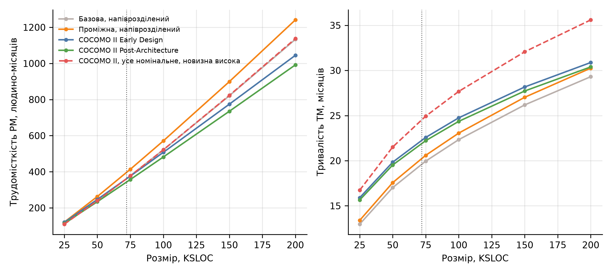

# Мета роботи

Навчитися використовувати інструменти за моделлю COCOMO для розрахунку економічних показників розробки програмного забезпечення.

# Завдання

1. Розрахувати трудомісткість розробки програмного застосунку використовуючи за базовою та проміжною моделями COCOMO. Для виконання роботи брати проєкти, що містять більше 25000 рядків коду.
2. Проаналізувати програмний застосунок на основі моделі COCOMO II (попередня та детальна оцінка).
3. Дослідити вплив розміру програмного коду (SIZE) на трудомісткість (PM) та час розробки проєкту (TM) для різних моделей COCOMO II.
4. Отримати значення PM та TM по всім моделям для одного й того ж значення параметра SIZE, обравши номінальний (середній) рівень складності проєкту, що має високу ступінь новизни.
5. Обов'язково навести проведені розрахунки з поясненням вибору всіх параметрів. Якщо параметр не використовувався (або дорівнює нулю) – вказати причину невикористання.

# 1. Вихідні дані

Оцінюється застосунок Shopizer, який розглядався в практичних роботах № 2–5 [1]. Він має понад 25 000 рядків коду. За вимірюванням практичної роботи № 2 основний код Java складається з:

- 72 016 рядків коду без коментарів і порожніх рядків (72.016 KLOC);
- 50 133 логічних операторів (50.133 KSLOC).

Для базової і проміжної моделей 1981 року одиницею розміру є тисячі рядків вихідного коду без коментарів [2], тому береться 72.016 KLOC. Для COCOMO II одиницею є тисячі логічних операторів (SEI) [3], тому основні розрахунки COCOMO II виконано за 50.133 KSLOC, а для порівняння з іншими моделями – і за 72.016. Зарплата – \$2 500 на місяць (медіана Middle, усі мови) [4], курс 45.666 грн за долар [5].

Позначення: $PM$ – трудомісткість у людино-місяцях, $TM$ – час розробки в місяцях, $N = PM / TM$ – середня кількість розробників.

# 2. Базова модель

Базова модель залежить лише від розміру і типу проєкту [2]:

$$PM = a \cdot SIZE^{b},\qquad TM = c \cdot PM^{d}.$$

Коефіцієнти за типами проєктів: органічний – 2.4, 1.05, 2.5, 0.38; напіврозділений – 3.0, 1.12, 2.5, 0.35; вбудований – 3.6, 1.20, 2.5, 0.32. Shopizer за розміром (72.0 KLOC) і складністю належить до напіврозділеного типу, як і в практичній роботі № 2. Результати за всіма типами наведено в таблиці 1.

Таблиця 1 – Базова модель COCOMO, SIZE = 72.016 KLOC

| Тип проєкту | PM, людино-місяців | TM, міс. | Розробн. | Вартість, \$ | Вартість, млн грн |
| ------------------------ | ---------------- | ----------- | --------------- | --------------- | -------------- |
| Органічний | 214.0 | 19.2 | 11.1 | 535 121 | 24.4 |
| Напіврозділений | 360.9 | 19.6 | 18.4 | 902 364 | 41.2 |
| Вбудований | 609.8 | 19.5 | 31.3 | 1 524 605 | 69.6 |

Для напіврозділеного типу $PM = 3.0 \cdot 72.016^{1.12} = 360.9$, $TM = 2.5 \cdot 360.9^{0.35} = 19.6$, $N = 18.4$, вартість \$902 364.

# 3. Проміжна модель

Проміжна модель додає 15 факторів вартості, добуток яких дає множник трудомісткості $EAF$ [2]:

$$PM = a \cdot SIZE^{b} \cdot EAF,\qquad EAF = \prod_{i=1}^{15} CD_i,$$

час розробки обчислюється так само, як у базовій моделі. Коефіцієнти $a$, $b$ для типів: органічний – 3.2 і 1.05, напіврозділений – 3.0 і 1.12, вбудований – 2.8 і 1.20. Рейтинги факторів Shopizer і їх обґрунтування наведено в таблиці 2.

Таблиця 2 – Фактори вартості проміжної моделі

| Фактор | Рівень | Значення | Обґрунтування |
| ---------------------- | ----------------- | --------------- | ---------------------------------------------- |
| RELY Необхідна надійність | Високий | 1.15 | помилки призводять до помітних фінансових втрат: замовлення і платежі |
| DATA Розмір бази даних | Номінальний | 1.00 | обсяг бази залежить від магазину, даних немає |
| CPLX Складність продукту | Високий | 1.15 | розрахунок цін, податків, доставки, пакування, безпека |
| TIME Обмеження швидкодії | Номінальний | 1.00 | використання процесора не обмежено вимогами |
| STOR Обмеження пам'яті | Номінальний | 1.00 | обмежень пам'яті немає |
| VIRT Нестійкість віртуальної машини | Номінальний | 1.00 | JVM і Spring Boot змінюються рідко |
| TURN Час відновлення | Номінальний | 1.00 | особливих вимог немає |
| ACAP Здібності аналітиків | Номінальний | 1.00 | склад команди невідомий, прийнято середній рівень |
| AEXP Досвід у предметній області | Номінальний | 1.00 | прийнято середній рівень |
| PCAP Здібності програмістів | Номінальний | 1.00 | прийнято середній рівень |
| VEXP Досвід з віртуальною машиною | Номінальний | 1.00 | прийнято середній рівень |
| LEXP Досвід з мовою програмування | Номінальний | 1.00 | прийнято середній рівень |
| MODP Сучасні методи розробки | Високий | 0.91 | код-рев'ю, модульна архітектура, шаблони Spring |
| TOOL Інструменти розробки | Високий | 0.91 | Maven, Docker, середовище розробки і CI |
| SCED Вимоги до графіка | Номінальний | 1.00 | графік не стиснуто |
| EAF |  | 1.095 | добуток множників |

Чотири фактори відрізняються від номіналу: RELY (1.15), CPLX (1.15), MODP (0.91) і TOOL (0.91), $EAF = 1.15 \cdot 1.15 \cdot 0.91 \cdot 0.91 = 1.095$. Решта 11 факторів мають номінальну оцінку 1.00, оскільки або немає вимог, що виходять за норму (TIME, STOR, VIRT, TURN, SCED), або немає даних про предметну область і склад команди (DATA, ACAP, AEXP, PCAP, VEXP, LEXP). Номінальне значення такого фактора не змінює добуток, тому його вплив нульовий.

Для напіврозділеного типу $PM = 3.0 \cdot 72.016^{1.12} \cdot 1.095 = 395.3$, $TM = 2.5 \cdot 395.3^{0.35} = 20.3$. Результати за типами наведено в таблиці 3.

Таблиця 3 – Проміжна модель COCOMO, SIZE = 72.016 KLOC

| Тип проєкту | PM, людино-місяців | TM, міс. | Розробн. | Вартість, \$ | Вартість, млн грн |
| ------------------------ | ---------------- | ----------- | --------------- | --------------- | -------------- |
| Органічний | 312.6 | 22.2 | 14.1 | 781 392 | 35.7 |
| Напіврозділений | 395.3 | 20.3 | 19.5 | 988 235 | 45.1 |
| Вбудований | 519.5 | 18.5 | 28.1 | 1 298 648 | 59.3 |

Для напіврозділеного типу проміжна модель дає на 9.5% більше, ніж базова (395.3 проти 360.9), оскільки вищі надійність і складність змінюють оцінку сильніше, ніж сучасні методи й інструменти.

# 4. COCOMO II

## 4.1. Формули

COCOMO II має дві стадії оцінки: попередню (Early Design) і детальну (Post-Architecture) [3, 6]. Формули в калібруванні COCOMO II.2000:

$$PM = A \cdot SIZE^{E} \cdot \prod_{i} EM_i,\qquad E = B + 0.01 \sum_{j=1}^{5} SF_j,$$

$$TM = C \cdot PM_{NS}^{F} \cdot \frac{SCED\%}{100},\qquad F = D + 0.2 \cdot (E - B),$$

де $A = 2.94$, $B = 0.91$, $C = 3.67$, $D = 0.28$, $SF_j$ – фактори масштабу, $EM_i$ – множники трудомісткості (7 для Early Design, 17 для Post-Architecture), $PM_{NS}$ – трудомісткість без множника SCED, $SCED\%$ – стиснення графіка (100% для номінального). Розмір $SIZE$ – у тисячах логічних операторів. Реалізацію формул перевірено за прикладом з керівництва: для $SIZE = 100$ і $E = 1.15$ отримано $PM = 586.6$ і $TM = 29.7$, що збігається з наведеним у керівництві [3].

## 4.2. Фактори масштабу

Фактори масштабу враховуються на обох стадіях (таблиця 4). Для Shopizer $\sum SF = 13.19$, $E = 0.91 + 0.01 \cdot 13.19 = 1.0419$, $F = 0.28 + 0.2 \cdot (1.0419 - 0.91) = 0.3064$.

Таблиця 4 – Фактори масштабу

| Фактор масштабу | Рівень | Значення | Обґрунтування |
| -------------------------- | ----------------- | --------------- | ------------------------------------------ |
| PREC Передбачуваність | Високий | 2.48 | типовий застосунок електронної комерції, домен добре відомий |
| FLEX Гнучкість розробки | Дуже високий | 1.01 | відкритий проєкт, вимоги виконуються з частковою відповідністю (some conformity) |
| RESL Розв'язання ризиків і архітектура | Високий | 2.83 | модульна архітектура з п'яти модулів, ризики розв'язано переважно (75%) |
| TEAM Згуртованість команди | Високий | 2.19 | розподілена спільнота, взаємодія в цілому кооперативна |
| PMAT Зрілість процесу | Номінальний | 4.68 | відповідає другому рівню CMM |
| Разом ΣSF |  | 13.19 | E = 0.91 + 0.01 · 13.19 = 1.0419 |

## 4.3. Попередня оцінка (Early Design)

Для Early Design використовується 7 множників (таблиця 5). Відхиляються від номіналу два: RCPX (1.33) і RUSE (1.07), $EM = 1.33 \cdot 1.07 = 1.423$. PERS, PDIF, PREX, FCIL і SCED номінальні (1.00): склад команди невідомий (PERS, PREX), платформа стандартна (PDIF), засоби і розподіленість взаємно компенсуються (FCIL: TOOL високий, SITE низький, сума оцінок 6), графік не стиснуто (SCED).

Таблиця 5 – Множники Early Design

| Множник | Рівень | Значення | Обґрунтування |
| ---------------------------- | ----------------- | --------------- | ---------------------------------------- |
| PERS Здібності персоналу | Номінальний | 1.00 | склад команди невідомий |
| RCPX Надійність і складність продукту | Високий | 1.33 | помітні фінансові втрати при помилках, висока складність |
| RUSE Повторне використання | Високий | 1.07 | платформа для різних вітрин |
| PDIF Складність платформи | Номінальний | 1.00 | стандартна JVM, обмежень немає |
| PREX Досвід персоналу | Номінальний | 1.00 | склад команди невідомий |
| FCIL Засоби і розподіленість | Номінальний | 1.00 | TOOL високий, SITE низький, сума оцінок 6 – номінальний рівень |
| SCED Графік розробки | Номінальний | 1.00 | графік не стиснуто |
| EM, добуток |  | 1.423 |  |

$$PM = 2.94 \cdot 50.133^{1.0419} \cdot 1.423 = 247.1,\qquad TM = 3.67 \cdot 247.1^{0.3064} = 19.9.$$

## 4.4. Детальна оцінка (Post-Architecture)

Post-Architecture використовує 17 множників (таблиця 6). П'ять відрізняються від номіналу: RELY (1.10), CPLX (1.17), RUSE (1.07), TOOL (0.90) і SITE (1.09), $EM = 1.10 \cdot 1.17 \cdot 1.07 \cdot 0.90 \cdot 1.09 = 1.351$. Решта 12 номінальні: немає вимог, що виходять за норму (DOCU, TIME, STOR, PVOL, SCED), або немає даних про склад команди (DATA, ACAP, PCAP, PCON, APEX, PLEX, LTEX).

Таблиця 6 – Множники Post-Architecture

| Множник | Рівень | Значення | Обґрунтування |
| ---------------------------- | ----------------- | --------------- | ---------------------------------------- |
| RELY Надійність | Високий | 1.10 | помилки призводять до помітних фінансових втрат |
| DATA Розмір бази даних | Номінальний | 1.00 | обсяг бази залежить від магазину, даних немає |
| CPLX Складність продукту | Високий | 1.17 | розрахунок цін, податків, доставки, безпека |
| RUSE Розробка для повторного використання | Високий | 1.07 | платформа, яку підключають різні вітрини |
| DOCU Документація | Номінальний | 1.00 | є документація API, інакше потреб немає |
| TIME Обмеження часу виконання | Номінальний | 1.00 | обмежень немає |
| STOR Обмеження пам'яті | Номінальний | 1.00 | обмежень немає |
| PVOL Нестійкість платформи | Номінальний | 1.00 | платформа змінюється рідко |
| ACAP Здібності аналітиків | Номінальний | 1.00 | склад команди невідомий |
| PCAP Здібності програмістів | Номінальний | 1.00 | склад команди невідомий |
| PCON Стабільність персоналу | Номінальний | 1.00 | дані відсутні |
| APEX Досвід у предметній області | Номінальний | 1.00 | склад команди невідомий |
| PLEX Досвід з платформою | Номінальний | 1.00 | склад команди невідомий |
| LTEX Досвід з мовою та інструментами | Номінальний | 1.00 | склад команди невідомий |
| TOOL Інструменти | Високий | 0.90 | Maven, Docker, середовище розробки і CI |
| SITE Розподіленість розробки | Низький | 1.09 | учасники розподілені, зв'язок через мережу |
| SCED Графік розробки | Номінальний | 1.00 | графік не стиснуто |
| EM, добуток |  | 1.351 |  |

$$PM = 2.94 \cdot 50.133^{1.0419} \cdot 1.351 = 234.6,\qquad TM = 3.67 \cdot 234.6^{0.3064} = 19.5.$$

## 4.5. Підсумок

Результати наведено в таблиці 7. Для порівняння з базовою і проміжною моделлю додано розрахунок для 72.016 KSLOC.

Таблиця 7 – COCOMO II для Shopizer

| Модель | Розмір, KSLOC | PM | TM | Розробників | Вартість, \$ | Вартість, млн грн |
| ---------------------- | ---------------------- | --------- | -------- | ----------------- | ------------- | -------------- |
| Early Design | 50.1 (логічні оператори) | 247.1 | 19.9 | 12.4 | 617 848 | 28.2 |
| Early Design | 72.0 (рядки коду) | 360.4 | 22.3 | 16.2 | 901 110 | 41.2 |
| Post-Architecture | 50.1 (логічні оператори) | 234.6 | 19.5 | 12.0 | 586 513 | 26.8 |
| Post-Architecture | 72.0 (рядки коду) | 342.2 | 21.9 | 15.6 | 855 409 | 39.1 |

Попередня і детальна оцінки відрізняються на 5% (247.1 і 234.6). Різниця виникає через два множники Early Design, які об'єднують кілька множників Post-Architecture: RCPX (1.33) проти добутку RELY і CPLX (1.10 · 1.17 = 1.287) та FCIL (1.00) проти добутку TOOL і SITE (0.90 · 1.09 = 0.981); RUSE однаковий (1.07). Основним результатом COCOMO II прийнято Post-Architecture: $PM = 234.6$, $TM = 19.5$ місяця, $N = 12.0$, вартість \$586 513 (26.8 млн грн).

# 5. Вплив розміру на трудомісткість і час розробки

Для розмірів 25, 50, 75, 100, 150 і 200 KSLOC розраховано $PM$ і $TM$ за базовою (напіврозділений тип), проміжною (з $EAF = 1.095$), Early Design і Post-Architecture моделями з рейтингами Shopizer, а також за COCOMO II з номінальними множниками і високою новизною (розділ 6). Результати наведено в таблицях 8 і 9 і на рисунку 1.

Таблиця 8 – Трудомісткість PM, людино-місяців

| Розмір, KSLOC | Базова | Проміжна | Early Design | Post-Architecture | Номінальна, висока новизна |
| -------------- | -------------- | -------------- | --------------- | ------------------ | --------------------- |
| 25 | 110.4 | 120.9 | 119.7 | 113.6 | 109.7 |
| 50 | 239.9 | 262.7 | 246.5 | 234.0 | 239.2 |
| 75 | 377.7 | 413.7 | 376.0 | 356.9 | 377.4 |
| 100 | 521.3 | 571.0 | 507.4 | 481.7 | 521.6 |
| 150 | 821.0 | 899.1 | 774.2 | 734.9 | 822.9 |
| 200 | 1 133.1 | 1 240.9 | 1 044.8 | 991.8 | 1 137.2 |

Таблиця 9 – Час розробки TM, місяців

| Розмір, KSLOC | Базова | Проміжна | Early Design | Post-Architecture | Номінальна, висока новизна |
| -------------- | -------------- | -------------- | --------------- | ------------------ | --------------------- |
| 25 | 13.0 | 13.4 | 15.9 | 15.6 | 16.7 |
| 50 | 17.0 | 17.6 | 19.8 | 19.5 | 21.5 |
| 75 | 20.0 | 20.6 | 22.6 | 22.2 | 24.9 |
| 100 | 22.3 | 23.1 | 24.7 | 24.4 | 27.7 |
| 150 | 26.2 | 27.0 | 28.2 | 27.7 | 32.1 |
| 200 | 29.3 | 30.3 | 30.9 | 30.4 | 35.6 |

{width=16cm}

Рисунок 1 – Вплив розміру на трудомісткість і час розробки (пунктир – розмір Shopizer)

Висновки:

1. Трудомісткість зростає швидше за розмір, бо показник степеня більший за 1. За базовою моделлю подвоєння розміру збільшує PM у 2.17 раза ($b = 1.12$), за Post-Architecture – у 2.06 раза ($E = 1.042$). Від 25 до 200 KSLOC розмір зростає в 8 разів, а PM – у 10.3 раза за базовою і в 8.7 раза за Post-Architecture.
2. Час розробки зростає значно повільніше: від 25 до 200 KSLOC у 2.26 раза за базовою моделлю і в 1.94 раза за Post-Architecture. Тому великі проєкти потребують більше розробників: за Post-Architecture середня кількість розробників зростає з 7.3 (25 KSLOC) до 32.6 (200 KSLOC).
3. COCOMO II за рейтингами Shopizer дає менший PM, ніж базова модель, починаючи з 50 KSLOC (234.0 проти 239.9; 481.7 проти 521.3 за 100 KSLOC), бо показник степеня $E = 1.042$ менший за 1.12. За 25 KSLOC результати близькі (113.6 проти 110.4).
4. Проміжна модель дає найбільші значення (571.0 за 100 KSLOC), бо $EAF = 1.095 > 1$.
5. Early Design і Post-Architecture відрізняються мало, різниця близько 5% на всьому діапазоні розмірів, бо вона зумовлена кількістю множників, а не розміром.

# 6. Однаковий розмір, номінальна складність, висока новизна

Для порівняння моделей взято один розмір 72.016 KSLOC і проєкт номінальної складності з високою новизною. Результати наведено в таблиці 10. Відповідно до цього:

- Усі множники трудомісткості EM, а також фактори проміжної моделі прийняті номінальними (1.00). Тому $EAF = 1$, $EM = 1$.
- Висока новизна означає, що аналогів проєкту мало: $PREC$ – дуже низький (6.20). Інші фактори масштабу – номінальні: $FLEX = 3.04$, $RESL = 4.24$, $TEAM = 3.29$, $PMAT = 4.68$. $\sum SF = 21.45$, $E = 0.91 + 0.01 \cdot 21.45 = 1.1245$, $F = 0.3229$.
- У базовій і проміжній моделях такого фактора немає, тому вони подані для всіх типів проєктів: новизна на вибір типу не впливає, його визначають обмеження і складність проєкту.

Таблиця 10 – Результати для однакового розміру

| Модель | PM, людино-місяців | TM, місяців |
| -------------------------------------------- | ---------------------- | -------------------- |
| Базова, органічний | 214.0 | 19.2 |
| Базова, напіврозділений | 360.9 | 19.6 |
| Базова, вбудований | 609.8 | 19.5 |
| Проміжна, органічний | 285.4 | 21.4 |
| Проміжна, напіврозділений | 360.9 | 19.6 |
| Проміжна, вбудований | 474.3 | 18.0 |
| COCOMO II Early Design | 360.6 | 24.6 |
| COCOMO II Post-Architecture | 360.6 | 24.6 |

Висновки:

1. Для COCOMO II Early Design і Post-Architecture результати збігаються (360.6 людино-місяців, 24.6 місяця), бо за номінальних множників різниця між стадіями зникає, а фактори масштабу однакові.
2. При високій новизні трудомісткість COCOMO II (360.6) близька до базової напіврозділеного типу (360.9), але це числовий збіг різних формул, а не свідчення про тип проєкту. Тривалість за COCOMO II більша (24.6 проти 19.6 місяця), бо показник $F = 0.3229$ вищий.
3. Проміжна модель для номінальних факторів збігається з базовою лише для напіврозділеного типу, бо їхні коефіцієнти $a$, $b$ рівні (3.0 і 1.12). Для органічного типу вона дає більше (285.4 проти 214.0), для вбудованого – менше (474.3 проти 609.8).
4. Високу новизну можна врахувати лише в COCOMO II: вона збільшує показник степеня $E$ з 1.042 до 1.125. За однакового розміру 72.0 KSLOC трудомісткість із номінальними множниками і високою новизною (360.6) на 5% більша, ніж за рейтингами Shopizer (342.2).

# 7. Аналіз результатів і верифікація

Порівняння результатів для Shopizer:

- базова модель (напіврозділений тип, 72.0 KLOC): 360.9 людино-місяців, 19.6 місяця;
- проміжна модель: 395.3 людино-місяців, 20.3 місяця;
- COCOMO II Early Design: 360.4 за 72.0 KSLOC і 247.1 за 50.1 KSLOC;
- COCOMO II Post-Architecture: 342.2 за 72.0 KSLOC і 234.6 за 50.1 KSLOC.

Різниця між моделями за однаковим розміром 72.0 не перевищує 16% (342.2–395.3). Значно більший вплив має одиниця розміру: перехід від рядків коду до логічних операторів зменшує оцінку на 31% (342.2 і 234.6). Тому, застосовуючи COCOMO II, необхідно вимірювати розмір саме в логічних операторах.

Порівняння з практичними роботами № 3–5: оцінка за функціональними точками 146.6 людино-місяця, за Feature points 158.4, за аналогією 125.8 (остання нестійка: без аналогів зі слабкою історією комітів вона зростає до 241–388). COCOMO II (235) і базова модель (361) більші в 1.5–2.9 раза, оскільки COCOMO охоплює повний цикл розробки від вимог до приймання, а оцінки за точками і аналогами, імовірно, відображають переважно обсяг програмування. Прямо це не перевірялося, тому пояснення є припущенням.

Перевірка. Реалізацію формул перевірено за прикладом з керівництва COCOMO II (100 KSLOC, $E = 1.15$: $PM = 586.6$, $TM = 29.7$) – збігається. Базова модель дає той самий результат, що в практичній роботі № 2 (360.9 і 19.6). Для номінальних множників Early Design і Post-Architecture збігаються (розділ 6), як і має бути за формулами.

Обмеження:

1. Склад команди Shopizer невідомий, тому множники, пов'язані з досвідом і здібностями, прийнято номінальними (5 з 15 факторів проміжної моделі і 6 з 17 множників Post-Architecture). Реальна команда може змінити оцінку в діапазоні, що визначається межами множників (наприклад, ACAP від 0.71 до 1.42).
2. Рейтинги експертні, їх обґрунтовано за кодом і конфігурацією. Зміна одного рівня змінює результат: наприклад, CPLX з високого на дуже високий збільшує PM на 14%.
3. Базова модель не враховує повторне використання бібліотек і готових компонентів (Spring Boot). COCOMO II допускає такий облік, але для нього потрібні дані про частку нового коду, яких немає.
4. Розрахунок для SIZE = 72.016 за COCOMO II виконано в рядках коду без коментарів для порівняння, хоча модель калібрована на логічних операторах.

# Висновки

У роботі виконано оцінку трудомісткості і часу розробки Shopizer за моделями COCOMO.

1. Базова модель (напіврозділений тип, 72.0 KLOC): $PM = 360.9$, $TM = 19.6$, вартість \$902 364. Проміжна модель з $EAF = 1.095$: $PM = 395.3$, $TM = 20.3$, вартість \$988 235.
2. COCOMO II за 50.1 KSLOC: Early Design – $PM = 247.1$, $TM = 19.9$; Post-Architecture – $PM = 234.6$, $TM = 19.5$, вартість \$586 513 (26.8 млн грн). Показник степеня $E = 1.0419$.
3. Із зростанням розміру від 25 до 200 KSLOC трудомісткість зростає в 8.7–10.3 раза, а час розробки лише в 1.94–2.26 раза, тому потрібна кількість розробників зростає.
4. За однакового розміру 72.0 KSLOC, номінальної складності і високої новизни COCOMO II дає $PM = 360.6$ і $TM = 24.6$.
5. Одиниця розміру впливає на оцінку сильніше, ніж вибір моделі: логічні оператори замість рядків коду зменшують результат на 31%.

# Список джерел

1. Shopizer: Java open source e-commerce software. URL: https://github.com/shopizer-ecommerce/shopizer, коміт 6a4a0a6 від 23.03.2025 (дата звернення: 04.11.2026).
2. Boehm B. W. Software Engineering Economics. Englewood Cliffs, NJ : Prentice-Hall, 1981. 767 p.
3. COCOMO II Model Definition Manual, Version 2.1. Center for Software Engineering, University of Southern California, 2000. URL: https://web.archive.org/web/2016/http://csse.usc.edu/csse/research/COCOMOII/cocomo2000.0/CII_modelman2000.0.pdf (дата звернення: 04.11.2026).
4. Зарплати українських розробників – літо 2026. DOU. 13.07.2026. URL: https://dou.ua/lenta/articles/salary-report-devs-summer-2026/ (дата звернення: 04.11.2026).
5. Офіційний курс гривні щодо іноземних валют на 04.11.2026: долар США 45.666 UAH. Національний банк України. URL: https://bank.gov.ua/NBUStatService/v1/statdirectory/exchange?valcode=USD&date=20261104&json (дата звернення: 04.11.2026).
6. Boehm B. W., Abts C., Brown A. W. et al. Software Cost Estimation with COCOMO II. Upper Saddle River, NJ : Prentice Hall, 2000. 544 p.
