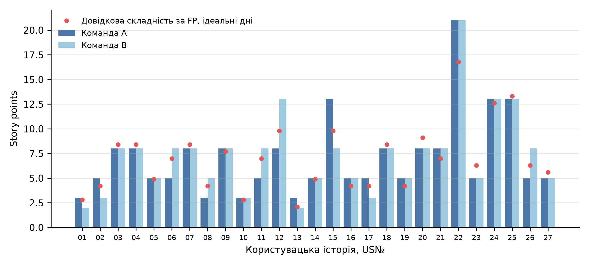
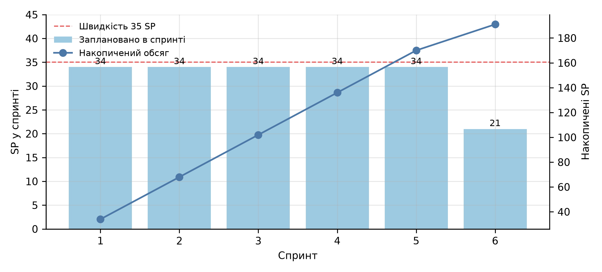

# Мета роботи

Ознайомитися та навчитися використовувати методи для розрахунку економічних показників розробки програмного забезпечення при застосуванні Agile методів.

# Завдання

1. Створити команди та обрати один з методів оцінки. Підстави для обрання методу.
2. Створити (обрати) зміст Product Backlog.
3. Виконати оцінку розміру за обраним методом.
4. Обчислити економічні показники Product Backlog (навести опис застосування методу на конкретному Product Backlog).
5. Скласти звіт відповідно до встановлених вимог оформлення та захистити роботи.

# 1. Команди і метод оцінки

## 1.1. Команди

Створено дві Scrum-команди, A і B, які оцінюють один Product Backlog незалежно. Склад кожної:

- п'ять учасників, які оцінюють: три Backend-розробники, QA-інженер і DevOps-інженер;
- Product Owner, який пояснює історії і не голосує;
- Scrum Master, який веде сесію оцінювання і не голосує.

Дві команди дозволяють перевірити, наскільки узгоджені оцінки різних команд, а також порівняти методи оцінки на однакових даних. Принципи гнучкої розробки сформульовано в Маніфесті Agile [@Manifesto], а ролі, артефакти і події Scrum описано в посібнику Scrum Guide [@Scrum2020].

## 1.2. Вибір методу

Розглянуто методи оцінки, які використовуються в Scrum (таблиця 1). Product Backlog містить 27 історій, їх оцінюють п'ятеро учасників, результат використовується для плану спринтів і розрахунку вартості.

Таблиця 1 – Вибір методу оцінки

| Метод | Придатність для цього Product Backlog |
| ---------------------- | -------------------------------------------------------------- |
| Planning Poker | Підходить: числові оцінки в послідовності Фібоначчі, обговорення розбіжностей, зручно для 20–50 історій |
| T-shirt Size | Груба оцінка за п'ятьма розмірами, підходить для попереднього огляду, але план спринтів потребує точніших чисел |
| Bucket System | Призначений для сотень елементів і кількох команд, для 27 історій надмірний |
| Dot Voting | Визначає пріоритет історій, а не їхній розмір |
| Large / Uncertain / Small | Три розміри, занадто грубо для розрахунку вартості |
| Ordering Method | Упорядковує елементи, а не оцінює їх у числах |
| Divide Until Maximum Size | Дає розбиття історій, але не оцінку їх розміру |

Обрано Planning Poker. Підстави: потрібні числові оцінки історій, щоб порахувати швидкість команди, спринти і вартість; кількість історій невелика, тому сесію можна провести за одну зустріч; обговорення голосів, які сильно відрізняються, виявляє приховані припущення і зменшує вплив одного учасника [@Cohn2005]. Для перевірки обґрунтування розділ 4 порівнює Planning Poker з T-shirt Size.

## 1.3. Процедура Planning Poker

Учасники мають колоду карт 0, 1, 2, 3, 5, 8, 13, 21, 34 і 55. Для кожної історії Product Owner пояснює її, учасники одночасно показують карти. Якщо карти відрізняються більше ніж на одне значення колоди, учасники з найбільшою і найменшою оцінкою пояснюють свої аргументи, і голосування повторюється. Остаточною оцінкою історії прийнято медіану голосів останнього раунду.

Одиниця story point визначена як один ідеальний день роботи однієї людини без перерв, який охоплює розробку і тестування історії. Це спрощення: у термінології Кона story point і ідеальний день є різними одиницями, але для розрахунку вартості їх зіставлено [@Cohn2005]. Окремо від цього введено фактор фокусу 0.7: команда фактично витрачає на історії лише частину робочого дня. Цей фактор не пов'язаний з довідковою складністю 0.7 ідеального дня на UFP, яка використана лише для побудови голосів; збіг значень випадковий.

Голосування команд відтворено програмою, а не проведено з реальними учасниками. У програмі кожен учасник сприймає складність історії як довідкову складність, помножену на власний коефіцієнт (відхилення 12%, у QA-інженера на 10% більше) і на випадковий множник (відхилення 25% для кожної історії), та голосує за найближчу карту. Після розбіжності більше ніж в одну карту голоси зближуються з медіаною (на 65% за раунд) з невеликим шумом, не більше чотирьох раундів. Довідкова складність історії – 0.7 ідеального дня на нескориговану функціональну точку (UFP) операцій, з яких вона складається, за підрахунком практичної роботи № 3. Початкові значення генератора випадкових чисел зафіксовано (7 для команди A і 11 для команди B), тому результати відтворюються.

# 2. Product Backlog

Product Backlog складено для першого релізу інтернет-магазину на основі Shopizer: від реєстрації клієнта і перегляду каталогу до оплати замовлення і керування товарами [@Shopizer]. Він містить 27 користувацьких історій. Кожна історія складається з операцій REST API (транзакцій з практичної роботи № 3), що наведено в таблиці 2. Пріоритети задано за методом MoSCoW: Must – обов'язкові для релізу (17 історій), Should – бажані (7), Could – за наявності часу (3).

Таблиця 2 – Product Backlog

<!-- TABLE_BACKLOG -->

Усі 27 історій складаються з 63 унікальних операцій API з нескоригованою складністю 272 UFP. Транзакції практичної роботи № 3 з однаковою нормалізованою назвою (версії API, псевдоніми шляхів) об'єднано в одну операцію, а її вага взята як найбільша з дублікатів, а не сума, тому 272 UFP є дещо консервативною оцінкою. З врахуванням $VAF = 1.10$ це 299.2 нормованих функціональних точок, 19.6% від розміру всього продукту (1 525). Решта функціональності, наприклад керування податками, користувачами, модулями і контентом, до першого релізу не входить.

# 3. Оцінка розміру

Результати голосування наведено в таблиці 3 і на рисунку 1. Для порівняння додано довідкову складність у днях, яка використовувалась як вихідна для голосів.

Таблиця 3 – Оцінки історій у story points

<!-- TABLE_VOTES -->

{width=16cm}

Рисунок 1 – Оцінки історій двома командами

Результати:

1. Команди A і B оцінили Product Backlog в 191 і 196 story points; довідкова складність становить 190.4 ідеального дня, тобто оцінки відрізняються від неї на 0.3% (команда A) і 2.9% (команда B).
2. У команди A 19 історій узгоджено з першого раунду, 8 – з другого; у команди B 14 і 13. Середня кількість раундів на історію – 1.30 і 1.48.
3. Оцінки команд збігаються для 17 з 27 історій (63.0%) і відрізняються не більше ніж на одну карту для всіх 27. Коефіцієнт кореляції рангів Спірмена між командами 0.86.
4. Оцінки обох команд корелюють із складністю за функціональними точками: коефіцієнт Спірмена 0.94 для команди A і 0.95 для команди B.
5. Найбільший розмір має керування категоріями (21 story point в обох командах), далі налаштування магазину (13) і керування платежами (13 в обох командах).

# 4. Порівняння методів оцінки

Щоб перевірити вибір методу, ті самі історії оцінено за методом T-shirt Size тими самими командами: розміри XS, S, M, L, XL відповідають 1, 3, 5, 8 і 13 story points, учасники голосують один раз, без обговорення, остаточна оцінка – медіана. Показники порівняння наведено в таблиці 4: сумарний обсяг, середня кількість раундів, середня відносна похибка оцінки історії порівняно з довідковою складністю і кореляція з функціональними точками.

Таблиця 4 – Порівняння Planning Poker і T-shirt Size

<!-- TABLE_METHODS -->

Висновки:

1. Planning Poker точніший: похибка 13.9–15.0% проти 15.5–18.6% для T-shirt Size, кореляція з функціональними точками вища (0.94–0.95 проти 0.86–0.89). Ймовірні причини: дрібніша шкала (у Planning Poker 9 значень, у T-shirt Size 5) і обговорення розбіжностей, якого в T-shirt Size немає; ці чинники змодельовано разом і розділити їх за цими даними неможливо.
2. T-shirt Size швидший (один раунд замість 1.3–1.5) і занижує обсяг: 182–185 story points проти 191–196. Частково це наслідок обмеження шкали: найбільший розмір XL дорівнює 13, а довідкова складність історії US22 близько 17 ідеальних днів.
3. Оцінки двох команд за T-shirt Size збігаються частіше: 74.1% історій проти 63.0% для Planning Poker. Це наслідок грубої шкали, а не вищої точності: при п'яти значеннях ймовірність збігу голосів вища.
4. У межах прийнятої моделі різниця в точності і затратах часу не суперечить вибору Planning Poker для планування спринтів, але не доводить його, бо голоси згенеровано з довідкової складності (див. розділ 6). T-shirt Size придатний для швидкого попереднього огляду великого Product Backlog.

# 5. Економічні показники

## 5.1. Швидкість і вартість спринту

Швидкість команди – обсяг story points, виконаний за спринт. Для нової команди без історії вона обчислюється за ємністю: п'ять учасників, спринт 10 робочих днів, фактор фокусу 0.7, тому

$$v = 5 \cdot 10 \cdot 0.7 = 35\ \text{story points на спринт}.$$

Вартість спринту визначається зарплатами команди. До п'яти учасників додано Scrum Master і Product Owner по 0.5 ставки, разом 6 повних ставок. Зарплата одного учасника – \$2 500 на місяць (медіана Middle, усі мови, DOU літо 2026) [@DOU2026], 21.67 робочого дня на місяць:

$$C_{sprint} = 6 \cdot 2\,500 \cdot \frac{10}{21.67} = \$6\,922.$$

Курс НБУ 45.666 грн за долар [@NBU].

## 5.2. Розрахунок для Product Backlog

Кількість спринтів – $\lceil SP / v \rceil = \lceil 191 / 35 \rceil = 6$ для команди A (5.46 спринта; для команди B 196 / 35 = 5.60, теж 6 спринтів). Тривалість 12 тижнів, вартість $6 \cdot 6\,922 = \$41\,532$ (1.90 млн грн), вартість story point $41\,532 / 191 = \$217$ для команди A ($41\,532 / 196 = \$212$ для команди B). Трудомісткість $6 \cdot 6 \cdot 10 / 21.67 = 16.6$ людино-місяця. Для обох команд кількість спринтів, тривалість і вартість однакові, бо 191 і 196 story points вміщуються в 6 спринтів; відрізняється лише вартість story point. Далі подано розрахунок для команди A.

Для порівняння ті самі історії оцінено за функціональними точками: $AFP = 299.2$ за продуктивності Java 10.4 FP на людино-місяць [@Jones2017] дають 28.8 людино-місяця, \$71 923 (3.28 млн грн), \$240 за функціональну точку. Результати наведено в таблиці 5.

Таблиця 5 – Економічні показники Product Backlog

<!-- TABLE_ECON -->

## 5.3. План релізу

Історії впорядковано за пріоритетом (Must, Should, Could) і розміщено в першому спринті, в якому вистачає вільної швидкості (таблиця 6, рисунок 2). Усі 17 історій Must потрапляють у перші чотири спринти, історії Should і Could розміщуються у вільних місцях цих спринтів і в п'ятому та шостому.

Таблиця 6 – План релізу за спринтами (команда A)

<!-- TABLE_PLAN -->

{width=14cm}

Рисунок 2 – Обсяг робіт за спринтами

# 6. Аналіз результатів і верифікація

Порівняння оцінки за Scrum з оцінкою за функціональними точками. Оцінка за story points (16.6 людино-місяця, \$41 532) становить 58% від оцінки за функціональними точками (28.8 людино-місяця, \$71 923). Причини розбіжності:

1. Оцінки не зіставні напряму. Продуктивність 10.4 FP на людино-місяць за 21.67 робочого дня означає 2.08 дня на AFP, тобто 2.29 дня на UFP (AFP = 1.10 · UFP) і охоплює весь життєвий цикл. План спринтів витрачає 6 · 10 · 6 = 360 людино-днів, тобто 1.32 дня на UFP. Із цих 360 днів 60 припадає на Scrum Master і Product Owner (по 0.5 ставки), а ще частина на заокруглення 5.46 спринта до 6. Оцінка за FP дає 623 людино-днів (28.8 людино-місяця), а це 28.8 · 21.67, тому 360 / 623 = 58%. Чисті ідеальні дні історій (191 story point) становлять 0.70 дня на UFP.
2. Для історій не враховано витрати поза роботою над історіями: вимоги до продукту, інтеграцію, супровід, виправлення дефектів після релізу.
3. Фактор фокусу 0.7 і склад команди є припущеннями; за швидкості 25 story points на спринт оцінка зросла б до 8 спринтів і \$55 376.

Узгодженість оцінок. Усі історії двох команд відрізняються не більше ніж на одну карту, коефіцієнт Спірмена між командами 0.86, з функціональними точками – 0.94–0.95. Сумарні оцінки збігаються з довідковою складністю в межах 2.9%.

Перевірка. Розрахунок реалізовано програмою, яка бере операції з практичної роботи № 3 і перевіряє, що всі 63 операції історій існують у цьому підрахунку. Сума ваг історій (272 UFP) збігається із сумою за таблицею 2. Нормована кількість точок 299.2 дорівнює $272 \cdot 1.10$. Спринтів $\lceil 191 / 35 \rceil = \lceil 196 / 35 \rceil = 6$ збігається з планом релізу.

Обмеження:

1. Голосування змодельовано, тому показники точності й узгодженості (похибка 14–15%, кореляція 0.94–0.95) описують поведінку методу за прийнятих припущень про розкид оцінок, а не реальної команди. Для реальних команд вони залежать від досвіду, прив'язки до перших оцінок і дисципліни обговорення.
2. Швидкість обчислена за ємністю, а не за історичними даними команди. Після перших спринтів її необхідно замінити фактичною.
3. Довідкова складність побудована з UFP, тобто оцінка Planning Poker не є незалежною від функціональних точок, і їх узгодженість не можна вважати незалежним підтвердженням точності.
4. Story points різних команд непорівнянні, бо кожна команда визначає їх по-своєму [@Cohn2005]. Тут обидві команди використовують одне визначення (ідеальний день).
5. Близькі сумарні оцінки двох команд (191 і 196) є наслідком вибраних початкових значень генератора (7 і 11), а не закономірністю.

# Висновки

У роботі створено дві Scrum-команди, складено Product Backlog з 27 користувацьких історій для першого релізу Shopizer і виконано оцінку за методом Planning Poker.

1. Обрано Planning Poker: числові оцінки потрібні для швидкості і вартості, історій небагато, а обговорення зменшує розбіжності. T-shirt Size, Bucket System, Dot Voting та інші методи для цієї задачі менш придатні.
2. Product Backlog містить 63 операції API з розміром 272 UFP (299.2 AFP). Команди A і B оцінили його в 191 і 196 story points; оцінки збіглись для 59% історій і відрізнялись не більше ніж на одну карту для решти.
3. За швидкості 35 story points на спринт backlog потребує 6 спринтів (12 тижнів) і 16.6 людино-місяця, вартість \$41 532 (1.90 млн грн), \$217 за story point.
4. T-shirt Size швидший, але менш точний (похибка 16–19% проти 14–15%); у межах прийнятої моделі це не суперечить вибору Planning Poker.
5. Оцінка за функціональними точками для тих самих історій складає 28.8 людино-місяця, \$71 923. Вона більша на 73%, бо охоплює весь життєвий цикл, а story points – лише розробку і тестування.

# Список джерел

<!-- SOURCES -->
